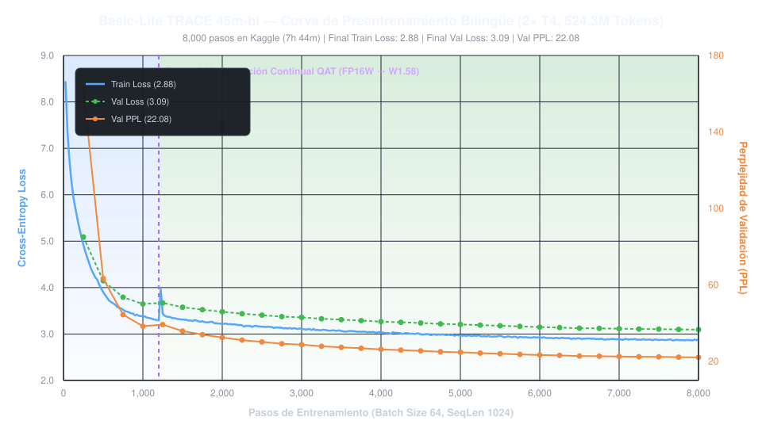
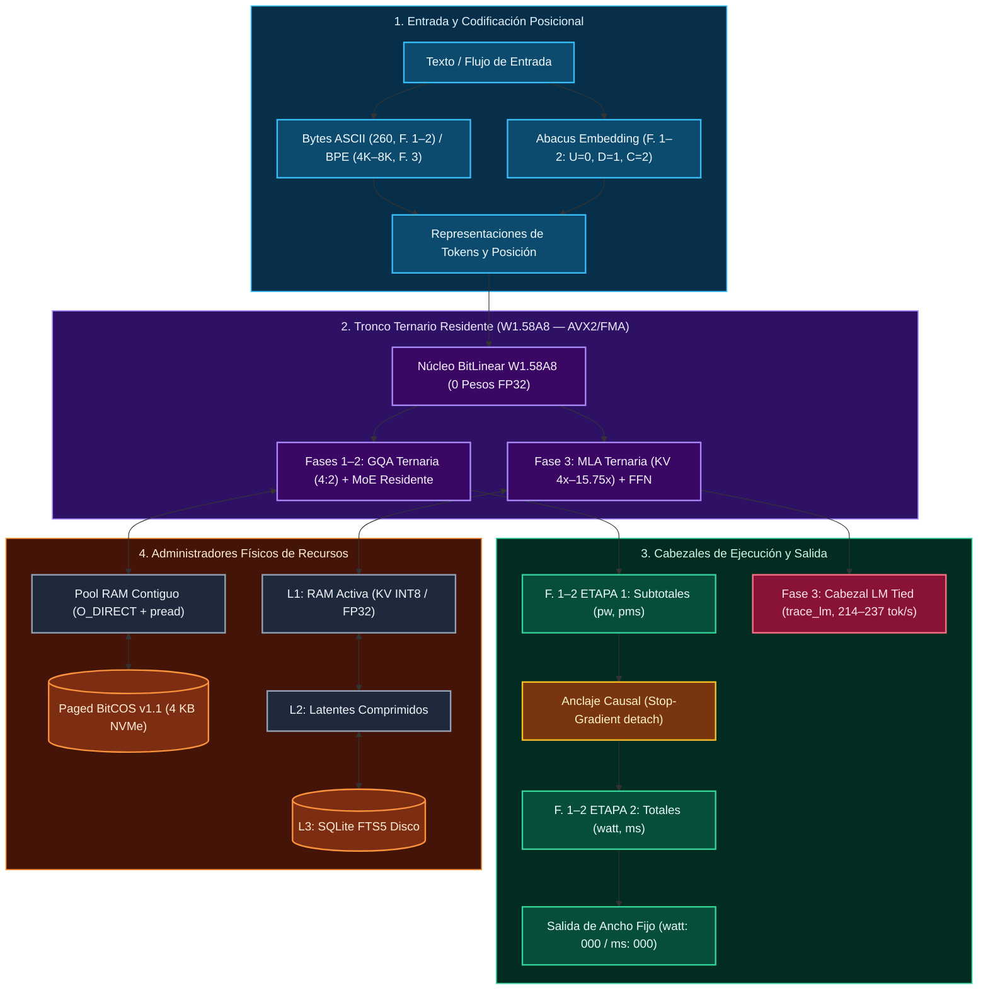

# Basic-Lite TRACE: Motor Nativo C (AVX2 + O_DIRECT) W1.58A8 para CPUs de Consumo

> **Idioma / Language:** [English](README.md) | **Español**


[](https://github.com/Miguel19x/Basic-Lite-TRACE/actions/workflows/ci.yml)

**Basic-Lite TRACE** (*Ternary Resident Architecture for Convergent Execution*) es una arquitectura neuronal y un motor de inferencia nativo en C de ultra-baja precisión (**W1.58A8**, **AVX2/FMA + `O_DIRECT` + MLA INT8 KV**) creado y dirigido por **Miguel19x**. Sobre un portátil estándar de 2 núcleos (**Intel Core i3-1115G4**, 16 GB RAM, SSD NVMe, Linux x86_64, sin GPU), el ejecutor standalone en C corre un **modelo de lenguaje bilingüe (EN/ES) 100% ternario de 47.2M parámetros** (`45m-bi`, binario alineado a 4 KB de **31.02 MB**) a **214–237 tokens/s** en **36.22 MB de RAM pico**, con paridad de exportación Python $\to$ C de `max_diff` $= 3.34 \times 10^{-6}$ y cero expansión de pesos a FP32 en RAM.

Arquitectónicamente, TRACE se rige por el principio de **residencia y ejecución selectivas** (`Paged BitCOS` alineado a 4 KB, enrutamiento MoE consciente de E/S física NVMe y memoria contextual en 3 niveles), diseñado para escalar hacia modelos MoE paginados en disco de miles de millones de parámetros desacoplando capacidad total en almacenamiento y RAM activa bajo protocolos pre-registrados reproducibles.

---

## 1. Resultados Empíricos y Benchmarks en Hardware Real

### 1.1. Fase 3 — Modelo de Lenguaje Bilingüe `45m-bi` W1.58 y Motor C Standalone (v1.4.0-trace, Hito 3.7)

El **Hito 3.7** culmina la Fase 3 con el preentrenamiento de un modelo de lenguaje autorregresivo bilingüe (EN/ES) 100% ternario W1.58 (**`45m-bi`**, **47.2M parámetros**) en Kaggle (`2× NVIDIA Tesla T4`, DDP, 7h 43m 03s) durante 8,000 pasos (**524.3M tokens**) con Continual QAT (warmup FP16W pasos 1–1200 $\to$ STE W1.58 estricto pasos 1201–8000), convergiendo a $\text{Train Loss} = 2.88$, $\text{Val Loss} = 3.09$, **$\text{Val PPL} = 22.08$** (informes completos: [docs/HITO_3_7_BENCHMARKS.md](docs/HITO_3_7_BENCHMARKS.md), [docs/FASE3_BENCHMARK.md](docs/FASE3_BENCHMARK.md)).

- **Dimensiones:** $L=14$, $d_{\text{model}}=640$, $d_{\text{ff}}=1280$ (Squared-ReLU), $n_{\text{heads}}=10$, MLA $d_c=160$, $d_h=64$, $d_{pe}=32$, $V=8,192$ BPE con *tied embeddings*.
- **Binario Físico (`Paged BitCOS v1.1`):** **31.02 MB** (32,522,240 bytes), 2,716 páginas de 4 KB alineadas para `O_DIRECT`, paridad de exportación `max_diff` $= 3.34 \times 10^{-6}$.



#### Rendimiento Standalone en CPU (`Intel Core i3-1115G4`, 2 núcleos físicos, `OMP_NUM_THREADS=2`)
Evaluación empírica con `/usr/bin/time -v ./trace_lm` midiendo 100 tokens generados:

| Despacho ISA | Modo KV Cache | TTFT Greedy (ms) | Throughput Greedy (tok/s) | Sampling Throughput (tok/s) | Memoria RAM Pico (Max RSS) | Speedup vs Escalar |
| :--- | :---: | :---: | :---: | :---: | :---: | :---: |
| **AVX2 + FMA** | **INT8 KV** (default) | **16.94 ± 2.17 ms** | **214.53 ± 27.31 tok/s** | **162.81 tok/s** | **36.22 MB** | **8.11× / 20.49× TTFT** |
| **AVX2 + FMA** | **FP32 KV** (`--no_int8_kv`) | **18.17 ± 1.90 ms** | **237.26 ± 10.78 tok/s** | **171.48 tok/s** | **36.66 MB** | **9.76× / 20.79× TTFT** |
| **Scalar C99** | **INT8 KV** | 347.09 ± 69.78 ms | 26.47 ± 3.48 tok/s | 20.89 tok/s | 36.22 MB | Línea Base Escalar INT8 |
| **Scalar C99** | **FP32 KV** | 377.73 ± 74.55 ms | 24.30 ± 0.17 tok/s | 24.91 tok/s | 36.89 MB | Línea Base Escalar FP32 |

### 1.2. Fase 1 — Convergencia Aritmética Composicional (v1.2.0-trace, 5 Semillas Fijadas)
Evaluación formal sobre las 5 semillas oficiales (`42, 123, 456, 789, 999`) al paso 6000 en CPU (2 hilos i3-1115G4), reportada en [results/eval_fase1_bitnet_5semillas_results.json](results/eval_fase1_bitnet_5semillas_results.json):

| Métrica | Fase 2b (Línea Base) | **Fase 1 (BitNet QAT Schedule, v1.2.0)** | Impacto / Delta |
| :--- | :---: | :---: | :---: |
| **Exact Match Total (Full-EM en Test-Comp)** | $19.04\% \pm 22.73\%$ (Mediana: $8.75\%$) | **$90.29\% \pm 13.44\%$** (Mediana: **$95.21\%$**) | **+71.25 pp** |
| **Exact Match Scratchpad ($P_w, P_{ms}$)** | $98.21\% \pm 1.01\%$ | **$100.00\% \pm 0.00\%$** (480/480 en 5 semillas) | **+1.79 pp** |
| **Exactitud Aislada en Dígitos** | $88.20\% \pm 5.61\%$ | **$98.94\% \pm 1.58\%$** | **+10.74 pp** |
| **Train-200 Full-EM (sin reemplazo)** | $24.90\% \pm 26.23\%$ | **$99.70\% \pm 0.27\%$** | **+74.80 pp** |
| **DEV Full-EM (108 casos)** | $21.67\% \pm 25.64\%$ | **$94.81\% \pm 10.07\%$** | **+73.14 pp** |
| **Test-Azar Full-EM (240 casos)** | $19.58\% \pm 22.84\%$ | **$94.58\% \pm 8.18\%$** | **+75.00 pp** |
| **Calibración ECE en Test-Comp** | *No registrado* | **$0.61\%$** (Etapa 2: $1.22\%$) | **Calibración Óptima** |

```text
[Semilla  42] Test-Comp: EM = 94.17% (452/480) | SP-EM = 100.00% | ECE = 0.37% | DEV: EM =  98.15%
[Semilla 123] Test-Comp: EM = 66.46% (319/480) | SP-EM = 100.00% | ECE = 2.01% | DEV: EM =  76.85%
[Semilla 456] Test-Comp: EM = 98.96% (475/480) | SP-EM = 100.00% | ECE = 0.06% | DEV: EM = 100.00%
[Semilla 789] Test-Comp: EM = 95.21% (457/480) | SP-EM = 100.00% | ECE = 0.35% | DEV: EM = 100.00%
[Semilla 999] Test-Comp: EM = 96.67% (464/480) | SP-EM = 100.00% | ECE = 0.25% | DEV: EM =  99.07%
------------------------------------------------------------------------------------------------------
Media Global : Test-Comp: EM = 90.29% ± 13.44% (IC95 Bootstrap: [78.04%, 97.29%])
Scratchpad EM: Test-Comp: EM = 100.00% ± 0.00% (480/480 en las 5 semillas)
```

*(Línea base histórica pre-registrada v1.0.0: Test-Comp Full-EM $5.12\% \pm 4.88\%$, Scratchpad EM $81.88\% \pm 10.14\%$; véase [results/eval_confirmatorio_5semillas_results.json](results/eval_confirmatorio_5semillas_results.json)).*

---

## 2. Inicio Rápido y Reproducción

```bash
# 1. Crear entorno virtual e instalar dependencias CPU
python3 -m venv venv && source venv/bin/activate
pip install -r requirements.txt

# 2. Compilar motor nativo C y kernels (GCC + OpenMP + AVX2, -Wall -Wextra -Werror -Wvla)
OMP_NUM_THREADS=2 make clean && make all

# 3. Ejecutar suite de verificación
OMP_NUM_THREADS=2 make test

# 4. Inferencia standalone en C (requiere binario Paged BitCOS v1.1 + tokenizador BPE)
./trace_lm --prompt "Once upon a time, a curious engineer" --temp 0.0 --max_tokens 30
./trace_lm --prompt "El algoritmo de inferencia profunda" --temp 0.7 --top_p 0.9 --rep_pen 1.15 --max_tokens 35

# 5. Entrenamiento piloto local en CPU del Campo Causal en 2 Etapas (2 hilos físicos)
python train.py --steps 1000 --batch_size 32 --warmup_ratio 0.40 --device cpu
```

> [!NOTE]
> Los binarios y checkpoints (`*.pt`, `*.bin`) se excluyen del control de versiones vía `.gitignore`. Pueden generarse localmente o consultarse por versión en [GitHub Releases](https://github.com/Miguel19x/Basic-Lite-TRACE/releases) (último release publicado: `v1.3.0-trace`; el artefacto de `v1.0.0-trace` es histórico e incompatible con `v1.2.0+`).

---

## 3. Esquema de Arquitectura y Cinco Ejes Canónicos



### Pilares y Cinco Ejes Fundamentales
1. **Paginación Binaria a Nivel de SO (`Paged BitCOS v1 / v1.1`):** Pesos ternarios estrictos $\{-1, 0, 1\}$ ([trace/layers/bitlinear.py](trace/layers/bitlinear.py)) ejecutados directamente desde **páginas alineadas a 4096 bytes** vía `O_DIRECT` + `pread` y kernels C AVX2/FMA ([csrc/paged_dispatch.c](csrc/paged_dispatch.c), [csrc/paged_gemm_avx2.c](csrc/paged_gemm_avx2.c), [trace/serialization/paged_bitcos.py](trace/serialization/paged_bitcos.py)).
2. **Enrutamiento MoE Consciente de Memoria Física:** Penaliza expertos no residentes mediante $S(e) = U(e) - \lambda C_{\text{lectura}}(e) - \mu C_{\text{cómputo}}(e)$ con contingencia *buddy expert* ([trace/modules/paged_moe.py](trace/modules/paged_moe.py)).
3. **Multi-Head Latent Attention (MLA) y Memoria Contextual en 3 Niveles:** Compresión latente KV ([trace/lm/mla.py](trace/lm/mla.py), **4×–8×** FP32, **15.75×** INT8 KV) acoplada a RAM activa, latentes comprimidos y persistencia SQLite FTS5 ([trace/core/context_manager.py](trace/core/context_manager.py)).
4. **Tokenización Compacta Bytes/BPE:** Evolucionada desde bytes ASCII (260 tokens, Fase 1–2) hacia un tokenizador BPE compacto nativo en C ([csrc/lm/trace_tokenizer.c](csrc/lm/trace_tokenizer.c), [trace/lm/tokenizer.py](trace/lm/tokenizer.py), vocabulario 4K–8K con dígitos 1:1 y *tied embeddings*) en Fase 3.
5. **Abacus Embeddings y Campo Causal en 2 Etapas:** Rangos decimales invertidos vectorizados ([trace/layers/abacus.py](trace/layers/abacus.py)) + anclaje causal con `detach()` ([trace/models/causal.py](trace/models/causal.py)) + currículo Staged Warmup ([train.py](train.py)).

### Matriz de Decisiones Arquitectónicas (ADR)

| Decisión Arquitectónica | Justificación Técnica | Ventaja Validada | Compensación (*Trade-Off*) |
| :--- | :--- | :--- | :--- |
| **Paged BitCOS v1 (4 KB)** | Ejecución directa `O_DIRECT` sin inflar capas a FP32. | 1.58 bits/peso; lecturas alineadas a páginas del SO. | Exige empaquetado matricial en múltiplos de 4 KB. |
| **Router MoE con Costo de E/S** | Evitar saturación PCIe/NVMe por intercambio indiscriminado. | Ahorro de transferencias priorizando expertos residentes en RAM. | Requiere calibrar $\lambda_{\text{read}}$ y *buddy experts*. |
| **Multi-Head Latent Attention** | Reducir tensores KV retenidos en RAM activa. | Ahorro 4×–15.75× en RAM KV (FP32 / INT8). | Añade proyección lineal de descompresión en inferencia. |
| **Abacus Embeddings** | Simetría de orden decimal (U, D, C) sobre dígitos ASCII. | Eleva exactitud de dígitos de 60.5% a >81.9% (98.94% en v1.2). | Requiere suma acumulativa invertida en entrada. |
| **Campo Causal en 2 Etapas** | Eliminar colapso de Exact Match por factorización paralela. | Full-EM escala de 0% a 90.29% ± 13.44% (pico 98.96%). | Requiere dos pasadas hacia adelante en inferencia. |
| **Staged Warmup Curriculum** | Evitar que ruido de Etapa 1 destruya el aprendizaje de Etapa 2. | Convergencia estable bajo scheduled sampling. | Requiere calibrar duración de calentamiento ($40\%$). |

---

## 4. Estructura del Repositorio

```
.
├── .github/                                  # CI (Ubuntu + ASan/UBSan) y plantillas de gobernanza
├── csrc/                                     # Motor nativo C modular (O_DIRECT, AVX2/FMA, OpenMP)
│   ├── lm/                                   # Motor C autorregresivo LM (BPE, MLA, KV INT8, trace_lm)
│   ├── paged_dispatch.{c,h}                  # Dispatch thread-safe escalar / AVX2 para GEMM ternario
│   ├── paged_gemm_avx2.c / _scalar.c         # Micro-kernels GEMM AVX2 Add-Sub y C99 portable
│   ├── trace_loader.c / trace_causal.c       # Cargador O_DIRECT 4 KB y CLI causal (trace_infer)
│   └── trace_infer.h / trace_math.h / paged_unpack.h
├── trace/                                    # Paquete modular Python canónico
│   ├── core/                                 # Gestor de contexto 3 niveles (RAM/Latente/SQLite FTS5)
│   ├── layers/                               # Abacus, BitLinear W1.58A8, FFN, RMSNorm, RoPE, Embeddings
│   ├── lm/                                   # TRACELanguageModel, MLA ternaria, config y BPE
│   ├── modules/                              # Atención, PagedMoE y SharedResidentTernaryCore
│   ├── models/                               # TRACECausalModel (Campo Causal en 2 Etapas)
│   ├── ops/                                  # Enlaces ctypes con libpaged_gemm.so y ops CPU
│   └── serialization/                        # Serialización y lectura Paged BitCOS v1 / v1.1
├── scripts/ / notebooks/                     # Corpus LM, entrenamiento DDP, benchmarks y piloto GPU
├── tests/                                    # 15 suites de verificación (AVX2, O_DIRECT, paridad, MLA, E0, CLI)
├── docs/                                     # Benchmarks, procedencia, SHA-256 + RFC 3161 (.tsr)
├── results/                                  # Registros experimentales confirmatorios y benchmarks JSON
├── pyproject.toml / requirements.txt / Makefile / ruff.toml
├── LICENSE.txt / LICENSE-EN.md               # Licencia Source-Available vinculante (ES) y referencia (EN)
├── CONTRIBUTING.md / CODE_OF_CONDUCT.md / SECURITY.md / NOTICE.md / AUTHORS.md / CHANGELOG.md
└── THIRD_PARTY_NOTICES.md / licenses/        # Atribuciones de terceros (BSD-3, MIT, Dominio Público)
```

---

## 5. Colaboración, Licencias y Cita

### Modelo de Colaboración (Estilo SQLite en 3 Canales)
Basic-Lite TRACE se publica bajo licencia **Source-Available** para habilitar escrutinio científico, docencia y evaluación técnica legítima reservando la explotación comercial. Siguiendo un modelo similar al de **SQLite**, el núcleo no fusiona *pull requests* externos sin acuerdo bilateral previo, pero ofrece **tres canales activos** (véase [CONTRIBUTING.md](CONTRIBUTING.md)):

* **Benchmarks comunitarios en hardware diverso (Issues):** Ejecuta `make all` / `./trace_lm` en otras CPUs (AMD Ryzen, Intel AVX-512, ARM64) y comparte tus mediciones reproducibles.
* **Diagnósticos técnicos y reportes (Issues):** Reporta fallos o analiza cuellos de botella (p. ej. optimización del *prefill* en frío en `csrc/lm/trace_lm_infer.c`).
* **Equipo núcleo (Acuerdo bilateral):** Buscamos colaboradores en **Sistemas C/SIMD/Linux** e **Investigación y Escalado ML (PyTorch)**. La mejor puerta de entrada es abrir una Issue técnica de calidad o escribir a `miguelaranguren19x@outlook.com`.

### Titularidad, Propiedad Intelectual y Gobernanza
* **Titular Exclusivo e Inventor:** Miguel19x (`miguelaranguren19x@outlook.com`)
* **Licencia:** [LICENSE.txt](LICENSE.txt) (licencia Source-Available vinculante en español; investigación, docencia y PoC de 30 días previa notificación escrita; explotación comercial/SaaS y entrenamiento/destilación de IA comercial reservados) · Traducción informativa en inglés: [LICENSE-EN.md](LICENSE-EN.md)
* **Gobernanza y Políticas:** [NOTICE.md](NOTICE.md) · [CONTRIBUTING.md](CONTRIBUTING.md) · [CODE_OF_CONDUCT.md](CODE_OF_CONDUCT.md) · [SECURITY.md](SECURITY.md) · [AUTHORS.md](AUTHORS.md) · [CHANGELOG.md](CHANGELOG.md) · [THIRD_PARTY_NOTICES.md](THIRD_PARTY_NOTICES.md)
* **Procedencia e Integridad Criptográfica:** [docs/PROVENANCE.md](docs/PROVENANCE.md) · [docs/RELEASE_MANIFEST.md](docs/RELEASE_MANIFEST.md) (sello externo RFC 3161: `docs/RELEASE_MANIFEST.md.tsr`) · [docs/AI_ASSISTANCE.md](docs/AI_ASSISTANCE.md)

### Cita Académica y Licenciamiento Comercial
```bibtex
@misc{miguel19x2026basiclitetrace,
  author = {Miguel19x},
  title = {Basic-Lite TRACE: Ternary Resident Architecture for Convergent Execution on Consumer CPUs},
  year = {2026},
  publisher = {GitHub},
  howpublished = {\url{https://github.com/Miguel19x/Basic-Lite-TRACE}}
}
```

Para **licenciamiento comercial**, **notificaciones de inicio de PoC (30 días)** o **consultoría C/SIMD**, contactar a **Miguel19x** en `miguelaranguren19x@outlook.com`.
