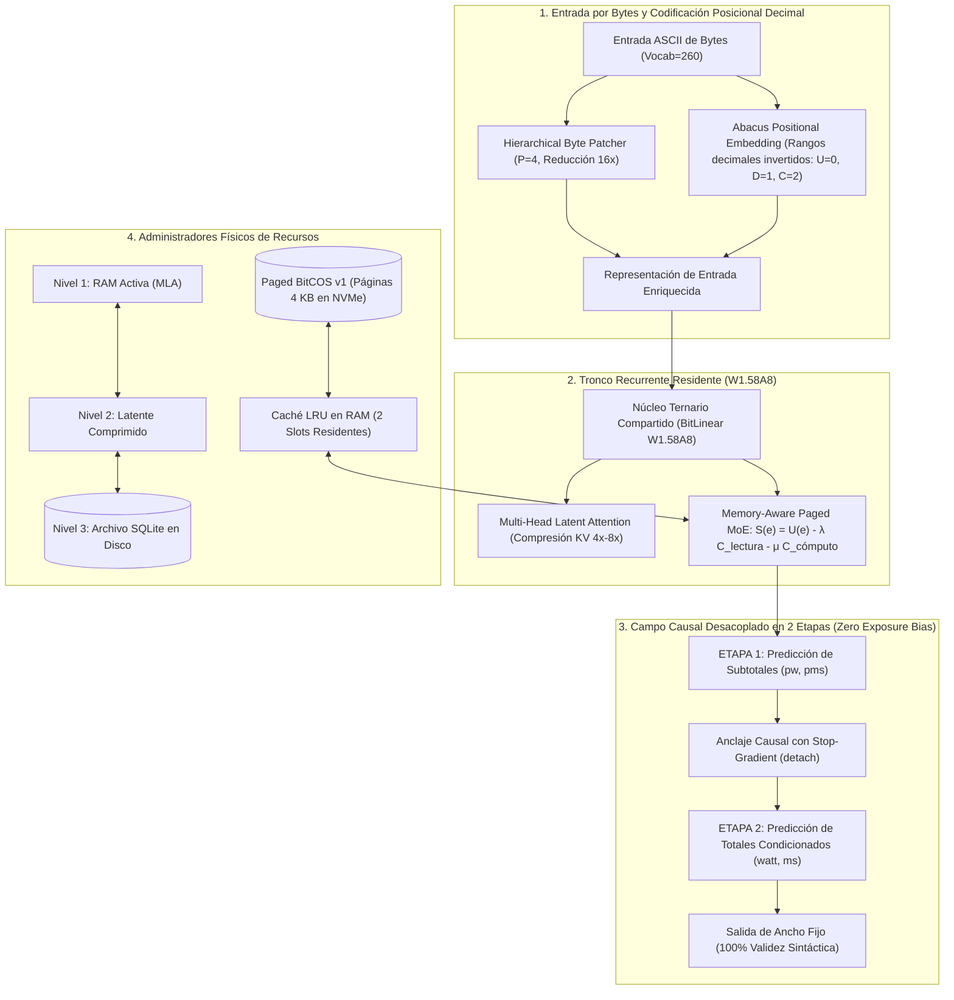

# Basic-Lite TRACE: Motor de Ejecución y Residencia Selectiva para Modelos Masivos en Hardware de Consumo


[](https://github.com/Miguel19x/Basic-Lite-TRACE/actions/workflows/ci.yml)

**Basic-Lite TRACE** (*Ternary Resident Architecture for Convergent Execution*) es una arquitectura neuronal y un motor de inferencia de ultra-baja precisión (**W1.58A8**) creado y dirigido por **Miguel19x**. Su objetivo arquitectónico es viabilizar modelos de escala masiva (diseñados para escalar hasta **30B parámetros**) sobre hardware estándar de consumo (**Intel Core i3-1115G4**, 2 núcleos / 4 hilos, 16 GB RAM, SSD NVMe, Linux x86_64), sin GPU dedicada y sin descomprimir matrices completas a FP32 en RAM.

El diseño se rige por el principio de **residencia y ejecución selectivas**: desacoplar la capacidad total almacenada en disco (páginas ternarias empaquetadas W1.58 alineadas a 4 KB) de la memoria residente activa en cada paso, bajo protocolos experimentales pre-registrados y reproducibles.

---

## 1. La Arquitectura TRACE y sus Pilares de Convergencia

La arquitectura **TRACE** (*Ternary Resident Architecture for Convergent Execution*) integra los siguientes principios:

* **Ternary (Ternario W1.58A8 — Preservado al 100%):**  
  Todas las proyecciones nucleares operan con cuantización ternaria $\{-1, 0, 1\}$ mediante [trace/layers/bitlinear.py](trace/layers/bitlinear.py) con estimador de gradiente recto (STE). En runtime, los tensores se ejecutan directamente sobre páginas binarias sin inflar matrices a FP32 en RAM mediante los kernels C fusionados ([csrc/paged_dispatch.c](csrc/paged_dispatch.c), [csrc/paged_gemm_avx2.c](csrc/paged_gemm_avx2.c)) y el formato [Paged BitCOS v1](trace/serialization/paged_bitcos.py).

* **Resident / Recursive (Residencia Selectiva y Recursividad Dinámica):**  
  El núcleo residente compartido ([trace/modules/resident_core.py](trace/modules/resident_core.py)) no apila capas densas tradicionales, sino que reitera $R$ pasos de recursión sobre un estado latente dual: razonamiento profundo ($z_r$) y respuesta ($y_r$). Incluye codificación sinusoidal continua de profundidad $e_r$ y una compuerta adaptativa de parada temprana (*adaptive halting gate*).

* **Convergent / Causal (Campo Causal Desacoplado en 2 Etapas):**  
  El mecanismo de generación en producción es el **Campo Causal Desacoplado en 2 Etapas con `detach()`** ([trace/models/causal.py](trace/models/causal.py)). Este desacopla la predicción de subtotales multiplicativos ($pw, pms$) de las sumas finales ($watt, ms$). Con la introducción del schedule QAT de 2 etapas estilo BitNet b1.58 (Fase 1, v1.2.0-trace), el Full-EM escala a **$90.29\% \pm 13.44\%$** en Test-Composicional (con pico de **$98.96\%$** en Semilla 456 y media de **$99.70\%$** en Train-200), resolviendo los subtotales al **$100.00\%$** con una calibración esperada ECE de **$0.61\%$**.

---

## 2. Esquema Global de Arquitectura



---

## 3. Los Cinco Ejes Arquitectónicos Fundamentales

### 3.1. Eje 1: Paginación Binaria a Nivel de Sistema Operativo (Paged BitCOS v1)
* **Principio:** Consumir tensores directamente empaquetados mediante lectura directa de almacenamiento (`O_DIRECT`) con *page pool* alineado y núcleos C optimizados en AVX2, eliminando la expansión flotante a FP32 en RAM y eludiendo la caché de página del sistema operativo.
* **Alineación:** Bloques alineados estrictamente a **4096 bytes** (tamaño nativo de página de memoria del kernel Linux).
* **Formatos de empaquetado ([trace/serialization/paged_bitcos.py](trace/serialization/paged_bitcos.py)):**
  * `compact`: Bit de presencia + bit de signo para minimizar ancho de banda PCIe/NVMe.
  * `fast`: Empaquetado directo de 2 bits por peso con tablas de consulta (LUT) y operaciones de suma/resta directa.

### 3.2. Eje 2: Enrutamiento MoE Consciente de Memoria Física
* **Principio:** Penalizar dinámicamente la activación de expertos que no residen en la memoria RAM:
  $$S(e) = U(e) - \lambda C_{\text{lectura}}(e) - \mu C_{\text{cómputo}}(e)$$
  * $C_{\text{lectura}}(e) = 0$ si el experto ya reside en la caché LRU en RAM.
  * $C_{\text{lectura}}(e) > 0$ si requiere transferencia física desde almacenamiento secundario NVMe.
* **Mecanismo de Escape y Buddy Experts ([trace/modules/paged_moe.py](trace/modules/paged_moe.py)):** Si la afinidad $U(e)$ supera el umbral crítico, se autoriza la lectura física; en escenarios de restricción temporal estricta, el ruteador despacha a un experto sustituto residente (*buddy expert*) para eludir la detención de I/O.

### 3.3. Eje 3: Multi-Head Latent Attention (MLA) y Memoria Contextual en 3 Niveles
* **MLA ([trace/lm/mla.py](trace/lm/mla.py)):** Comprime las matrices de claves y valores (KV) hacia un cuello de botella latente conjunto $c_t^{KV}$, reduciendo el tamaño de la caché de atención activa entre **4× y 8×** (hasta **15.75×** con cuantización KV INT8) frente a GQA o atención estándar.
* **Desacoplamiento Contextual ([trace/core/context_manager.py](trace/core/context_manager.py)):**
  * *Nivel 1 (Activo):* Ventana de atención directa en RAM.
  * *Nivel 2 (Comprimido):* Resúmenes latentes de bloques temporales previos.
  * *Nivel 3 (Archivo Persistente):* Almacenamiento exacto en SQLite sobre disco para recuperación sin pérdidas de hechos numéricos e históricos.

### 3.4. Eje 4: Compresión Jerárquica de Bytes (P=4) y Tokenización BPE Compacta
* **Principio:** Preservar la compacidad del vocabulario y el alineamiento exacto de dígitos (1:1) mientras se mitiga el costo cuadrático de atención.
* **Evolución de implementación:** En los experimentos causales fundacionales (Fase 1–2) se operó directamente sobre bytes ASCII (vocabulario 260); para el modelo de lenguaje autorregresivo de Fase 3 se consolidó un tokenizador **BPE compacto nativo en C** ([csrc/lm/trace_tokenizer.c](csrc/lm/trace_tokenizer.c) y [trace/lm/tokenizer.py](trace/lm/tokenizer.py), vocabulario 4K–8K con dígitos 1:1 y *tied embeddings*).

### 3.5. Eje 5: Abacus Embeddings y Campo Causal en 2 Etapas
* **Abacus Positional Embeddings ([trace/layers/abacus.py](trace/layers/abacus.py)):** Extrae mediante cálculo 100% vectorizado los rangos decimales relativos de derecha a izquierda (unidades=0, decenas=1, centenas=2) para tokens numéricos ASCII, dotando al transformador de conciencia del valor posicional.
* **Campo Causal en 2 Pasadas ([trace/models/causal.py](trace/models/causal.py)):** Desacopla la aritmética compuesta en dos etapas con `detach()`:
  1. *Etapa 1:* Predice subtotales multiplicativos ($P_w, P_{ms}$).
  2. *Anclaje Causal:* Inyecta los subtotales en la secuencia de entrada como hechos consumados del contexto con corte de gradiente.
  3. *Etapa 2:* Predice las sumas multivariables finales ($watt, ms$).
* **Currículo Staged Warmup ([train.py](train.py)):** En las primeras épocas fija `sched_p = 1.0` con datos exactos (*ground truth*) para que la Etapa 2 aprenda a sumar sin verse contaminada por predicciones iniciales ruidosas; luego decae gradualmente hacia $0.70$ para mitigar el sesgo de exposición (*exposure bias*).

---

## 4. Resultados Experimentales y Evolución Arquitectónica (5 Semillas)

### 4.1. Resultados Consolidados de Fase 1 (v1.2.0-trace — BitNet b1.58 Schedule)
Evaluación formal sobre los 5 checkpoints finales al paso 6000 (`_last.pt`) en CPU (2 hilos i3-1115G4), reportada en [results/eval_fase1_bitnet_5semillas_results.json](results/eval_fase1_bitnet_5semillas_results.json):

| Métrica | Fase 2b (Línea Base) | **Fase 1 (BitNet QAT Schedule, v1.2.0)** | Impacto / Delta |
| :--- | :---: | :---: | :---: |
| **Exact Match Total (Full-EM en Test-Comp)** | $19.04\% \pm 22.73\%$ (Mediana: $8.75\%$) | **$90.29\% \pm 13.44\%$** (Mediana: **$95.21\%$**) | **+71.25 pp (Generalización Masiva)** |
| **Exact Match Scratchpad ($P_w, P_{ms}$)** | $98.21\% \pm 1.01\%$ | **$100.00\% \pm 0.00\%$** (480/480 en 5 semillas) | **+1.79 pp (Etapa 1 Perfecta)** |
| **Exactitud Aislada en Dígitos** | $88.20\% \pm 5.61\%$ | **$98.94\% \pm 1.58\%$** | **+10.74 pp** |
| **Train-200 Full-EM (sin reemplazo)** | $24.90\% \pm 26.23\%$ | **$99.70\% \pm 0.27\%$** | **+74.80 pp (Ajuste Casi Perfecto)** |
| **DEV Full-EM (108 casos)** | $21.67\% \pm 25.64\%$ | **$94.81\% \pm 10.07\%$** | **+73.14 pp** |
| **Test-Azar Full-EM (240 casos)** | $19.58\% \pm 22.84\%$ | **$94.58\% \pm 8.18\%$** | **+75.00 pp** |
| **Calibración ECE en Test-Comp** | *No registrado* | **$0.61\%$** (Etapa 2: $1.22\%$) | **Calibración Óptima** |

```text
[Semilla  42] Test-Comp: EM = 94.17% (452/480) | SP-EM = 100.00% | ECE = 0.37% | DEV: EM =  98.15%
[Semilla 123] Test-Comp: EM = 66.46% (319/480) | SP-EM = 100.00% | ECE = 2.01% | DEV: EM =  76.85%
[Semilla 456] Test-Comp: EM = 98.96% (475/480) | SP-EM = 100.00% | ECE = 0.06% | DEV: EM = 100.00%
[Semilla 789] Test-Comp: EM = 95.21% (457/480) | SP-EM = 100.00% | ECE = 0.35% | DEV: EM = 100.00%
[Semilla 999] Test-Comp: EM = 96.67% (464/480) | SP-EM = 100.00% | ECE = 0.25% | DEV: EM =  99.07%
------------------------------------------------------------------------------------------------------
Media Global : Test-Comp: EM = 90.29% ± 13.44% (IC95 Bootstrap: [78.04%, 97.29%])
Scratchpad EM: Test-Comp: EM = 100.00% ± 0.00% (480/480 en las 5 semillas)
```

### 4.2. Antecedentes Pre-registrados Históricos (v1.0.0-trace)

Los experimentos fundacionales se ejecutaron bajo el protocolo pre-registrado oficial ([Protocolo pre-registrado — Basic-Lite (TRDM-v5), Fase 1.md](Protocolo%20pre-registrado%20%E2%80%94%20Basic-Lite%20(TRDM-v5),%20Fase%201.md)), evaluando 3000 pasos en las 5 semillas oficiales (`42, 123, 456, 789, 999`) y reportados en [results/eval_confirmatorio_5semillas_results.json](results/eval_confirmatorio_5semillas_results.json):
- Media Test-Comp Full-EM histórica: $5.12\% \pm 4.88\%$ (Máx: $13.33\%$).
- Scratchpad EM histórica: $81.88\% \pm 10.14\%$.

### 4.3. Estado Actual, Perfil de Hardware y Rendimiento Nativo C

Basic-Lite TRACE se encuentra consolidado en su versión **v1.4.0-trace**, con la **Fase 1 (Convergencia QAT y Calibración)**, la **Fase 2 (Motor Nativo C TRACE O_DIRECT)** y la **Fase 3 (Modelo de Lenguaje Autorregresivo con MLA y Motor C Standalone)** completadas y verificadas con 0 discrepancias frente a PyTorch:

| Parámetro del Prototipo Evaluado | Valor Medido en Hardware Base (`i3-1115G4`) |
| :--- | :--- |
| **Parámetros del checkpoint actual** | ~47.2M parámetros (`45m-bi`, $L=14$, $d=640$, $n_{\text{heads}}=10$, $d_{\text{ff}}=1280$) |
| **Consumo pico de RAM en inferencia** | **36.22 MB** en ejecución C standalone en CPU (AVX2 + INT8 KV) |
| **Entorno verificado** | Linux x86_64 (GCC 13+ con OpenMP y AVX2, Python 3.11, PyTorch CPU) |
| **Rendimiento Motor C (`trace_lm`)** | **214 a 237 tokens/s** en decodificación autorregresiva (TTFT < 18 ms) |
| **I/O Storage Nativo C** | `O_DIRECT` con 2 syscalls contiguas `pread` para pool de páginas alineado a 4096 bytes (31.02 MB binario) |
| **Optimización Matricial C** | Kernel AVX2 Add-Sub en registros vectoriales sin contención de hilos (`OMP_NUM_THREADS=2`) |
| **Avance de optimización clave** | Preentrenamiento bilingüe (524.3M tokens en Kaggle `2× T4`, $\text{Val PPL}=22.08$) con paridad de exportación $3.34\times 10^{-6}$ |

### 4.4. Resultados Consolidados de Fase 3 (v1.4.0-trace — Hito 3.7: Preentrenamiento Bilingüe 45m-bi W1.58 y Motor C Standalone)

El **Hito 3.7** culmina la Fase 3 con el primer preentrenamiento a gran escala de un modelo de lenguaje autorregresivo bilingüe (EN/ES) 100% ternario W1.58 (**`45m-bi`**, 47.2M parámetros) entrenado en Kaggle sobre `2× NVIDIA Tesla T4` durante 8,000 pasos (524.3M tokens) y exportado al formato alineado de ejecución por páginas `Paged BitCOS v1.1` (reporte completo en [docs/HITO_3_7_BENCHMARKS.md](docs/HITO_3_7_BENCHMARKS.md)).

#### Especificaciones del Modelo `45m-bi` y Formato Paged BitCOS v1.1
- **Dimensiones:** $L=14$ capas Transformer, $d_{\text{model}}=640$, $d_{ff}=1280$ (Squared-ReLU), $n_{\text{heads}}=10$.
- **Atención Latente (MLA):** Rango de compresión KV $d_c = 160$ ($4\times$ menor a MHA estándar), $d_h=64$, $d_{pe}=32$ (RoPE desacoplado intercalado), $d_v=64$.
- **Vocabulario y Ligadura:** $V=8,192$ tokens (tokenizador BPE bilingüe nativo EN/ES), tied embeddings (`lm_head.weight is tok_emb.weight`).
- **Almacenamiento Físico:** 2,716 páginas de 4096 bytes alineadas para lectura directa `O_DIRECT`. Binario ultracompacto de **31.02 MB** (32,522,240 bytes).
- **Paridad de Exportación Python $\to$ `.bin`:** $\text{max\_diff} = 3.34 \times 10^{-6}$ (0 parámetros corruptos).

#### Preentrenamiento Distribuido en Kaggle (`2× NVIDIA Tesla T4`, DDP)
- **Duración total:** 7 horas, 43 minutos y 3 segundos (27,783 s).
- **Tokens procesados:** 524.3M tokens (Batch Size 64, longitud de secuencia 1024).
- **Continual QAT:** Warmup continuo FP16W (pasos 1–1200, 22,700 tok/s promedio) transicionando a cuantización ternaria estricta W1.58 con estimador STE (pasos 1201–8000, 18,286 tok/s promedio).
- **Convergencia final:** $\text{Train Loss} = 2.88$, $\text{Val Loss} = 3.09$, $\mathbf{\text{Val Perplexity (PPL)} = 22.08}$.


#### Rendimiento Standalone en CPU (`Intel Core i3-1115G4`, 2 núcleos físicos, `--cpu_threads 2`)
Evaluación empírica con `/usr/bin/time -v ./trace_lm` midiendo 100 tokens generados:

| Despacho ISA | Modo KV Cache | TTFT Greedy (ms) | Throughput Greedy (tok/s) | Sampling Throughput (tok/s) | Memoria RAM Pico (Max RSS) | Speedup vs Escalar |
| :--- | :---: | :---: | :---: | :---: | :---: | :---: |
| **AVX2 + FMA** | **INT8 KV** (default) | **16.94 ± 2.17 ms** | **214.53 ± 27.31 tok/s** | **162.81 tok/s** | **36.22 MB** | **8.11× / 20.49× TTFT** |
| **AVX2 + FMA** | **FP32 KV** (`--no_int8_kv`) | **18.17 ± 1.90 ms** | **237.26 ± 10.78 tok/s** | **171.48 tok/s** | **36.66 MB** | **9.76× / 20.79× TTFT** |
| **Scalar C99** | **INT8 KV** | 347.09 ± 69.78 ms | 26.47 ± 3.48 tok/s | 20.89 tok/s | 36.22 MB | Línea Base Escalar INT8 |
| **Scalar C99** | **FP32 KV** | 377.73 ± 74.55 ms | 24.30 ± 0.17 tok/s | 24.91 tok/s | 36.89 MB | Línea Base Escalar FP32 |

#### Comandos de Reproducción Rápida
```bash
# 1. Compilar motor nativo C standalone
OMP_NUM_THREADS=2 make clean && make all

# 2. Inferencia en inglés (greedy)
./trace_lm --prompt "Once upon a time, a curious engineer" --temp 0.0 --max_tokens 30

# 3. Inferencia en español (sampling con Top-P y Repetition Penalty)
./trace_lm --prompt "El algoritmo de inferencia profunda" --temp 0.7 --top_p 0.9 --rep_pen 1.15 --max_tokens 35
```

---

## 5. Matriz de Decisiones Arquitectónicas (ADR)

| Decisión Arquitectónica | Justificación Técnica | Ventaja Validada | Compensación (*Trade-Off*) |
| :--- | :--- | :--- | :--- |
| **Paged BitCOS v1 (4 KB)** | Habilitar ejecución directa y mapeo `mmap` sin inflar capas a FP32. | Reducción a 1.58 bits por peso; lecturas alineadas a páginas del SO. | Exige empaquetado matricial en múltiplos del tamaño de página. |
| **Router MoE con Costo de E/S** | Evitar saturación del canal PCIe/NVMe con intercambio indiscriminado de módulos. | Ahorro masivo de transferencias conservando módulos frecuentes en RAM. | Requiere calibrar $\lambda_{\text{read}}$ y prever *buddy experts* ante fallos de caché. |
| **Multi-Head Latent Attention** | Reducir tensores de atención activa retenidos en memoria de trabajo. | Descompresión latente de KV; ahorro de 4×–8× en RAM activa. | Añade una proyección lineal para descomprimir $K$ y $V$ en inferencia. |
| **Abacus Embeddings** | Dotar a tokens de bytes ASCII de simetría de orden de magnitud decimal (U, D, C). | Eleva la exactitud de dígitos del 60.5% a >81.9% y facilita el cálculo. | Requiere vectorización de suma acumulativa invertida en capas de entrada. |
| **Campo Causal en 2 Etapas** | Eliminar el colapso de Exact Match por factorización paralela independiente. | Permite resolución exacta en cálculo acoplado (Full-EM escala de 0% a 90.29% ± 13.44%, pico 98.96%). | Requiere dos pasadas hacia adelante en inferencia (una por etapa). |
| **Staged Warmup Curriculum** | Evitar que errores de la Etapa 1 destruyan el aprendizaje aditivo de la Etapa 2. | Convergencia estable de la adición multivariable con scheduled sampling. | Requiere calibrar la duración de la fase de calentamiento ($40\%$ de los pasos). |

---

## 6. Estructura Limpia del Repositorio

```
.
├── .github/                                  # Automatización, CI y gobernanza en GitHub
│   ├── ISSUE_TEMPLATE/                       # Plantillas de reporte con aviso de privacidad y seguridad
│   ├── PULL_REQUEST_TEMPLATE.md              # Aviso de política de PRs y titularidad única
│   └── workflows/
│       └── ci.yml                            # Pipeline de CI en GitHub Actions (Ubuntu, Ruff, GCC, pytest)
├── csrc/                                     # Motor nativo C modular (O_DIRECT, AVX2/FMA, OpenMP)
│   ├── lm/                                   # Motor C autorregresivo de lenguaje (BPE, MLA, KV INT8, trace_lm)
│   ├── paged_dispatch.{c,h}                  # Dispatch dinámico escalar / AVX2 para GEMM ternario
│   ├── paged_gemm_avx2.c                     # Micro-kernel GEMM ternario AVX2 Add-Sub
│   ├── paged_gemm_scalar.c                   # Micro-kernel escalar C99 de referencia portable
│   ├── paged_unpack.h                        # Desempaquetado de páginas Paged BitCOS v1
│   ├── trace_infer.h / trace_math.h          # Cabeceras canónicas y rutinas matemáticas SIMD
│   ├── trace_loader.c                        # Cargador de pesos O_DIRECT alineado a 4096 bytes
│   └── trace_causal.c                        # Pipeline causal de 2 etapas y CLI standalone (trace_infer)
├── config.py                                 # Configuración unificada de hiperparámetros
├── data.py                                   # Generador procedural de datos y particiones científicas
├── train.py / eval.py                        # Entrenamiento (QAT BitNet b1.58) y evaluación en 2 etapas
├── export_paged.py / export_paged_lm.py      # Exportadores PyTorch -> Paged BitCOS v1 / v1.1
├── requirements.txt                          # Dependencias de entorno fijadas (PyTorch CPU, NumPy)
├── Makefile                                  # Compilación completa (libpaged_gemm, trace_infer, trace_lm)
├── LICENSE.txt / LICENSE-EN.md               # Licencia Source-Available vinculante (ES) y referencia (EN)
├── CONTRIBUTING.md / CODE_OF_CONDUCT.md      # Canales de colaboración (modelo SQLite) y conducta técnica
├── NOTICE.md / AUTHORS.md                    # Aviso de proyecto, autoría y créditos científicos
├── CHANGELOG.md / SECURITY.md                # Historial de versiones y divulgación responsable
├── THIRD_PARTY_NOTICES.md                    # Atribuciones y licencias de dependencias externas
├── Protocolo pre-registrado — Basic-Lite...  # Protocolo experimental congelado de Fase 1
├── results/                                  # Registros experimentales confirmatorios y benchmarks JSON
├── docs/                                     # Documentación técnica, roadmaps, procedencia y criptografía
│   ├── PROJECT_IDENTITY.md                   # Memoria de identidad técnica y convergencia TRACE
│   ├── PROVENANCE.md                         # Inventario de procedencia y cadena de custodia
│   ├── RELEASE_MANIFEST.md (+ .tsq / .tsr)   # Hashes SHA-256 y sello de tiempo externo RFC 3161
│   ├── AI_ASSISTANCE.md                      # Registro de asistencia por IA y autoría humana
│   ├── PAPER_TECNICO_BASIC_LITE.md           # Memoria técnica fundacional
│   ├── FASE3_BENCHMARK.md                    # Informe de benchmark de inferencia Fase 3 (25M)
│   ├── HITO_3_7_BENCHMARKS.md                # Resultados de preentrenamiento bilingüe 45m-bi (Hito 3.7)
│   └── ROADMAP_TRACE.md / ROADMAP_POST_FASE5.md # Hojas de ruta técnicas
├── scripts/ / notebooks/                     # Scripts de corpus, entrenamiento LM, benchmarks y piloto GPU
├── tests/                                    # Suites de verificación (AVX2, O_DIRECT, paridad, MLA, E0)
├── trace/                                    # Paquete modular Python canónico
│   ├── core/                                 # Gestor de contexto jerárquico (L1/L2/SQLite FTS5) y tipos
│   ├── layers/                               # Abacus, BitLinear W1.58A8, FFN, RMSNorm, RoPE, Embeddings
│   ├── lm/                                   # TRACELanguageModel, MLA ternaria, config y tokenizador BPE
│   ├── modules/                              # Atención, PagedMoE residente y SharedResidentTernaryCore
│   ├── models/                               # TRACECausalModel (Campo Causal en 2 Etapas)
│   ├── ops/                                  # Enlaces ctypes con libpaged_gemm.so y ops ternarias CPU
│   └── serialization/                        # Serialización y lectura Paged BitCOS v1 / v1.1
└── licenses/                                 # Textos completos de licencias de terceros
```

---

## 7. Instrucciones de Ejecución

### 7.1. Instalación y Preparación del Entorno
```bash
# 1. Crear y activar entorno virtual
python3 -m venv venv
source venv/bin/activate

# 2. Instalar dependencias base (optimizado para CPU)
pip install -r requirements.txt

# 3. Compilar el motor nativo C y kernels (requiere GCC con OpenMP y AVX2)
make all

# 4. (Opcional) Ejecutar suite de pruebas
make test
```

### 7.2. Ejecución Local en CPU (Intel Core i3)
```bash
# Entrenar corrida en CPU local (optimizado para 2 hilos físicos)
python train.py --steps 1000 --batch_size 32 --warmup_ratio 0.40 --device cpu
```

### 7.3. Evaluación del Checkpoint Oficial

> [!NOTE]
> Los binarios y checkpoints (`*.pt`, `*.bin`) se encuentran excluidos del control de versiones vía `.gitignore`. El checkpoint causal puede generarse localmente completando el entrenamiento piloto (sección 7.2) y los releases públicos se gestionan en [GitHub Releases](https://github.com/Miguel19x/Basic-Lite-TRACE/releases) (última versión publicada: `v1.3.0-trace`; el artefacto de `v1.0.0-trace` es histórico e incompatible con la arquitectura actual).
>
> [!WARNING]
> **Compatibilidad estructural (v1.2.0-trace):** Los checkpoints previos de `v1.0.0-trace` (`trace_column_checkpoint.pt`) son incompatibles con la arquitectura actual debido a la migración de `lm_head` a `nn.Linear(d_model, vocab_size, bias=False)` en FP32, el reemplazo de `time_emb` por `stage_emb = nn.Embedding(4, d_model)` para condicionamiento de etapas ($stage\_id \in \{0, 1, 2, 3\}$) y la máscara causal de target unificado `build_target_unified_mask`. Para evaluar el motor actual utilice los checkpoints generados bajo el schedule BitNet b1.58 de Fase 1 (`checkpoints/trace_s*_fase1_bitnet_last.pt`). Consulta [docs/ROADMAP_TRACE.md](docs/ROADMAP_TRACE.md) y [CHANGELOG.md](CHANGELOG.md).

```bash
# Evaluar el modelo en la partición reservada test-composicional
python -c "
import torch
from config import HybridConfig
from data import ProceduralCompositionalDataset
from trace.models.causal import TRACECausalModel
from eval import evaluate_causal

cfg = HybridConfig(device='cpu')
model = TRACECausalModel(cfg)
ckpt = torch.load('trace_checkpoint.pt', map_location='cpu', weights_only=False)
model.load_state_dict(ckpt['model_state'])
dataset = ProceduralCompositionalDataset(cfg, split='test-composicional')
results = evaluate_causal(model, dataset, torch.device('cpu'))
print('Resultados Test-Composicional:', results)
"
```

---

## 8. Visión de Proyecto, Colaboración y Equipo Núcleo

Basic-Lite TRACE se publica bajo una licencia **Source-Available** con un propósito claro: permitir escrutinio científico, docencia y evaluación técnica legítima, impidiendo al mismo tiempo la apropiación o explotación comercial no autorizada por terceros.

La hoja de ruta contempla llevar esta arquitectura desde su prototipo experimental hacia **modelos escalados y motores de inferencia de grado productivo** (eventualmente en modalidad privada/comercial). Siguiendo un modelo similar al de **SQLite**, el núcleo del repositorio no fusiona *pull requests* abiertos sin acuerdo previo para preservar la titularidad única y la coherencia científica, pero existen **tres canales activos de participación** (véase [CONTRIBUTING.md](CONTRIBUTING.md)):

* **Benchmarks comunitarios en hardware diverso (Issues):** Ejecuta `make all` / `./trace_lm` en tu CPU (AMD Ryzen, Intel AVX-512, ARM64) y comparte tus mediciones reproducibles.
* **Diagnósticos técnicos y reportes (Issues):** Reporta bugs o analiza cuellos de botella (p. ej. optimización del *prefill* en frío en `csrc/lm/trace_lm_infer.c`).
* **Equipo núcleo (Acuerdo bilateral):** Buscamos colaboradores en **Sistemas C/SIMD/Linux** (AVX2/AVX-512/NEON, `O_DIRECT`/`io_uring`) e **Investigación y Escalado ML (PyTorch)**. La mejor puerta de entrada es abrir una Issue técnica de calidad o escribir directamente a `miguelaranguren19x@outlook.com`.

---

## 9. Titularidad, Propiedad Intelectual y Licencias

* **Titular Exclusivo e Inventor:** Miguel19x (`miguelaranguren19x@outlook.com`)
* **Régimen de Licencia:** [LICENSE.txt](LICENSE.txt) — Licencia de código disponible (**Source-Available**, no de código abierto OSI) para investigación, docencia y evaluación técnica (con notificación previa para PoC de 30 días). Excluye explotación comercial directa y provisión SaaS/API sin acuerdo previo. Traducción informativa en inglés: [LICENSE-EN.md](LICENSE-EN.md).
* **Aviso de Proyecto y Alcance:** [NOTICE.md](NOTICE.md)
* **Directrices de Colaboración:** [CONTRIBUTING.md](CONTRIBUTING.md)
* **Código de Conducta:** [CODE_OF_CONDUCT.md](CODE_OF_CONDUCT.md)
* **Registro de Autores y Titulares:** [AUTHORS.md](AUTHORS.md)
* **Historial de Versiones:** [CHANGELOG.md](CHANGELOG.md)
* **Política de Seguridad:** [SECURITY.md](SECURITY.md)
* **Avisos de Terceros y Código Abierto:** [THIRD_PARTY_NOTICES.md](THIRD_PARTY_NOTICES.md) y carpeta [licenses/](licenses/)
* **Identidad y Memoria del Proyecto:** [docs/PROJECT_IDENTITY.md](docs/PROJECT_IDENTITY.md)
* **Inventario de Procedencia y Cadena de Custodia:** [docs/PROVENANCE.md](docs/PROVENANCE.md)
* **Manifiesto Criptográfico y Sello RFC 3161:** [docs/RELEASE_MANIFEST.md](docs/RELEASE_MANIFEST.md) (`docs/RELEASE_MANIFEST.md.tsr`)
* **Registro de Asistencia por IA:** [docs/AI_ASSISTANCE.md](docs/AI_ASSISTANCE.md)
* **Protocolo Pre-registrado Congelado:** [Protocolo pre-registrado — Basic-Lite (TRDM-v5), Fase 1.md](Protocolo%20pre-registrado%20%E2%80%94%20Basic-Lite%20(TRDM-v5),%20Fase%201.md)

---

## 10. Cita Académica y Servicios Profesionales

### Cómo Citar este Trabajo
Si utilizas la arquitectura Basic-Lite TRACE, sus métricas o su protocolo en investigaciones académicas o análisis técnicos, puedes citarlo como:

```bibtex
@misc{miguel19x2026basiclitetrace,
  author = {Miguel19x},
  title = {Basic-Lite TRACE: Ternary Resident Architecture for Convergent Execution on Consumer CPUs},
  year = {2026},
  publisher = {GitHub},
  howpublished = {\url{https://github.com/Miguel19x/Basic-Lite-TRACE}}
}
```

### Adaptaciones Empresariales y Consultoría
Para organizaciones o equipos interesados en:
1. **Evaluación de viabilidad técnica:** Analizar la ejecución de modelos de gran tamaño en servidores locales o edge sin GPUs de alto coste.
2. **Implementación y optimización a medida:** Despliegue de kernels en C y formatos paginados para hardware específico.
3. **Licenciamiento comercial privado:** Acuerdos comerciales para uso en entornos cerrados.

Contactar directamente con el fundador y responsable técnico:  
**Miguel19x** — `miguelaranguren19x@outlook.com`
