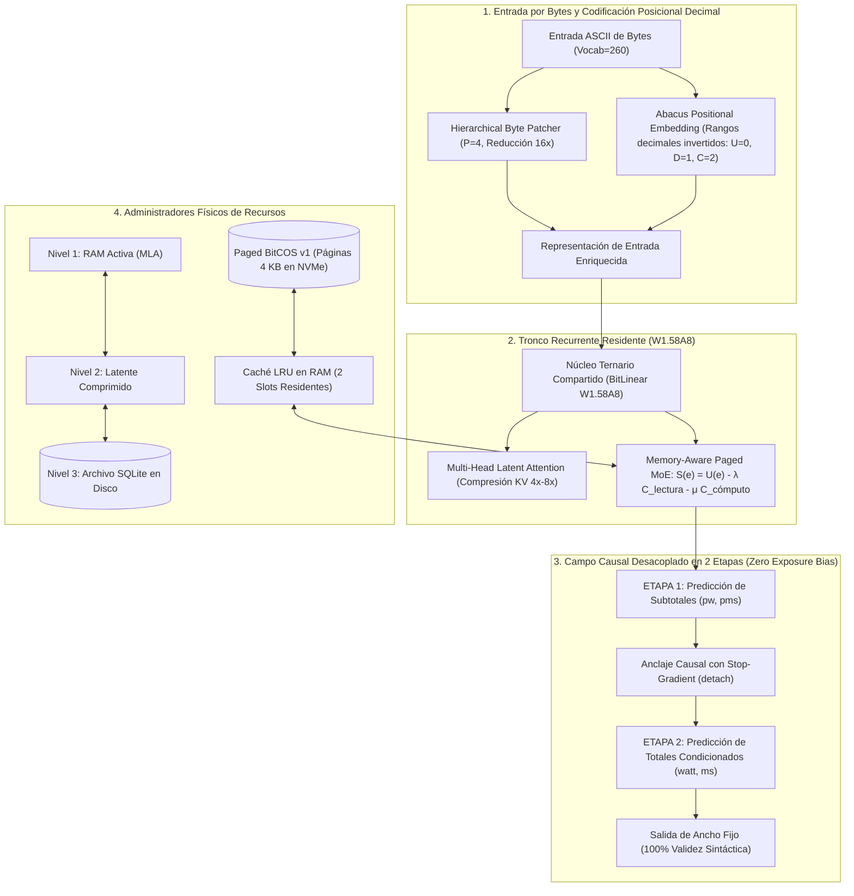

# Basic-Lite TRACE: Motor de Ejecución y Residencia Selectiva para Modelos Masivos en Hardware de Consumo


[](https://github.com/Miguel19x/Basic-Lite-TRACE/actions/workflows/ci.yml)

**Basic-Lite TRACE** (*Ternary Resident Architecture for Convergent Execution*) es una arquitectura neuronal y un motor de inferencia de ultra-baja precisión (**W1.58A8**) creado y dirigido por **Miguel19x**. Su objetivo arquitectónico es viabilizar modelos de escala masiva (diseñados para escalar hasta **30B parámetros**) sobre hardware estándar de consumo (**Intel Core i3-1115G4**, 2 núcleos / 4 hilos, 16 GB RAM, SSD NVMe, Linux x86_64), sin GPU dedicada y sin descomprimir matrices completas a FP32 en RAM.

El diseño se rige por el principio de **residencia y ejecución selectivas**: desacoplar la capacidad total almacenada en disco (páginas ternarias empaquetadas W1.58 alineadas a 4 KB) de la memoria residente activa en cada paso, bajo protocolos experimentales pre-registrados y reproducibles.

---

## 1. La Arquitectura TRACE y sus Pilares de Convergencia

La arquitectura **TRACE** (*Ternary Resident Architecture for Convergent Execution*) integra los siguientes principios:

* **Ternary (Ternario W1.58A8 — Preservado al 100%):**  
  Todas las proyecciones nucleares operan con cuantización ternaria $\{-1, 0, 1\}$ mediante [trace/layers/bitlinear.py](trace/layers/bitlinear.py) con estimador de gradiente recto (STE). En runtime, los tensores se ejecutan directamente sobre páginas binarias sin inflar matrices a FP32 en RAM mediante el kernel C fusionado ([paged_gemm_kernel.c](paged_gemm_kernel.c)) y el formato [Paged BitCOS v1](trace/serialization/paged_bitcos.py).

* **Resident / Recursive (Residencia Selectiva y Recursividad Dinámica):**  
  El núcleo residente compartido ([trace/modules/resident_core.py](trace/modules/resident_core.py)) no apila capas densas tradicionales, sino que reitera $R$ pasos de recursión sobre un estado latente dual: razonamiento profundo ($z_r$) y respuesta ($y_r$). Incluye codificación sinusoidal continua de profundidad $e_r$ y una compuerta adaptativa de parada temprana (*adaptive halting gate*).

* **Convergent / Causal (Campo Causal Desacoplado en 2 Etapas):**  
  El mecanismo de generación en producción es el **Campo Causal Desacoplado en 2 Etapas con `detach()`** ([trace/models/causal.py](trace/models/causal.py)). Este desacopla la predicción de subtotales multiplicativos ($pw, pms$) de las sumas finales ($watt, ms$). Con la introducción del schedule QAT de 2 etapas estilo BitNet b1.58 (Fase 1, v1.2.0-trace), el Full-EM escala a **$90.29\% \pm 13.44\%$** en Test-Composicional (con pico de **$98.96\%$** en Semilla 456 y media de **$99.70\%$** en Train-200), resolviendo los subtotales al **$100.00\%$** con una calibración esperada ECE de **$0.61\%$**.

---

## 2. Esquema Global de Arquitectura



---

## 3. Los Cinco Ejes Arquitectónicos Fundamentales

### 3.1. Eje 1: Paginación Binaria a Nivel de Sistema Operativo (Paged BitCOS v1)
* **Principio:** Consumir tensores directamente empaquetados mediante lectura directa de almacenamiento (`O_DIRECT`) con *page pool* alineado y núcleos C optimizados en AVX2, eliminando la expansión flotante a FP32 en RAM y eludiendo la caché de página del sistema operativo.
* **Alineación:** Bloques alineados estrictamente a **4096 bytes** (tamaño nativo de página de memoria del kernel Linux).
* **Formatos de empaquetado ([trace/serialization/paged_bitcos.py](trace/serialization/paged_bitcos.py)):**
  * `compact`: Bit de presencia + bit de signo para minimizar ancho de banda PCIe/NVMe.
  * `fast`: Empaquetado directo de 2 bits por peso con tablas de consulta (LUT) y operaciones de suma/resta directa.

### 3.2. Eje 2: Enrutamiento MoE Consciente de Memoria Física
* **Principio:** Penalizar dinámicamente la activación de expertos que no residen en la memoria RAM:
  $$S(e) = U(e) - \lambda C_{\text{lectura}}(e) - \mu C_{\text{cómputo}}(e)$$
  * $C_{\text{lectura}}(e) = 0$ si el experto ya reside en la caché LRU en RAM.
  * $C_{\text{lectura}}(e) > 0$ si requiere transferencia física desde almacenamiento secundario NVMe.
* **Mecanismo de Escape y Buddy Experts ([trace/modules/paged_moe.py](trace/modules/paged_moe.py)):** Si la afinidad $U(e)$ supera el umbral crítico, se autoriza la lectura física; en escenarios de restricción temporal estricta, el ruteador despacha a un experto sustituto residente (*buddy expert*) para eludir la detención de I/O.

### 3.3. Eje 3: Multi-Head Latent Attention (MLA) y Memoria Contextual en 3 Niveles
* **MLA ([trace/modules/mla_attention.py](trace/modules/mla_attention.py)):** Comprime las matrices de claves y valores (KV) hacia un cuello de botella latente conjunto $c_t^{KV}$, reduciendo el tamaño de la caché de atención activa entre **4× y 8×** frente a GQA o atención estándar.
* **Desacoplamiento Contextual ([trace/core/context_manager.py](trace/core/context_manager.py)):**
  * *Nivel 1 (Activo):* Ventana de atención directa en RAM.
  * *Nivel 2 (Comprimido):* Resúmenes latentes de bloques temporales previos.
  * *Nivel 3 (Archivo Persistente):* Almacenamiento exacto en SQLite sobre disco para recuperación sin pérdidas de hechos numéricos e históricos.

### 3.4. Eje 4: Compresión Jerárquica de Bytes (Hierarchical Byte Patching, P=4)
* **Principio:** Preservar la universalidad del vocabulario de bytes (260 tokens, sin tokenizador rígido dependiente del dominio) mientras se mitiga el costo cuadrático de atención.
* **Impacto ([trace/layers/byte_patcher.py](trace/layers/byte_patcher.py)):** Agrupar localmente $P=4$ bytes en vectores continuos divide la longitud efectiva de la secuencia por 4 ($L/4$), recortando el cálculo de atención recurrente en un factor de **$16\times$** ($P^2$).

### 3.5. Eje 5: Abacus Embeddings y Campo Causal en 2 Etapas
* **Abacus Positional Embeddings ([trace/layers/abacus.py](trace/layers/abacus.py)):** Extrae mediante cálculo 100% vectorizado los rangos decimales relativos de derecha a izquierda (unidades=0, decenas=1, centenas=2) para tokens numéricos ASCII, dotando al transformador de conciencia del valor posicional.
* **Campo Causal en 2 Pasadas ([trace/models/causal.py](trace/models/causal.py)):** Desacopla la aritmética compuesta en dos etapas con `detach()`:
  1. *Etapa 1:* Predice subtotales multiplicativos ($P_w, P_{ms}$).
  2. *Anclaje Causal:* Inyecta los subtotales en la secuencia de entrada como hechos consumados del contexto con corte de gradiente.
  3. *Etapa 2:* Predice las sumas multivariables finales ($watt, ms$).
* **Currículo Staged Warmup ([train.py](train.py)):** En las primeras épocas fija `sched_p = 1.0` con datos exactos (*ground truth*) para que la Etapa 2 aprenda a sumar sin verse contaminada por predicciones iniciales ruidosas; luego decae gradualmente hacia $0.70$ para mitigar el sesgo de exposición (*exposure bias*).

---

## 4. Resultados Experimentales y Evolución Arquitectónica (5 Semillas)

### 4.1. Resultados Consolidados de Fase 1 (v1.2.0-trace — BitNet b1.58 Schedule)
Evaluación formal sobre los 5 checkpoints finales al paso 6000 (`_last.pt`) en CPU (2 hilos i3-1115G4), reportada en [results/eval_fase1_bitnet_5semillas_results.json](results/eval_fase1_bitnet_5semillas_results.json):

| Métrica | Fase 2b (Línea Base) | **Fase 1 (BitNet QAT Schedule, v1.2.0)** | Impacto / Delta |
| :--- | :---: | :---: | :---: |
| **Exact Match Total (Full-EM en Test-Comp)** | $19.04\% \pm 22.73\%$ (Mediana: $8.75\%$) | **$90.29\% \pm 13.44\%$** (Mediana: **$95.21\%$**) | **+71.25 pp (Generalización Masiva)** |
| **Exact Match Scratchpad ($P_w, P_{ms}$)** | $98.21\% \pm 1.01\%$ | **$100.00\% \pm 0.00\%$** (480/480 en 5 semillas) | **+1.79 pp (Etapa 1 Perfecta)** |
| **Exactitud Aislada en Dígitos** | $88.20\% \pm 5.61\%$ | **$98.94\% \pm 1.58\%$** | **+10.74 pp** |
| **Train-200 Full-EM (sin reemplazo)** | $24.90\% \pm 26.23\%$ | **$99.70\% \pm 0.27\%$** | **+74.80 pp (Ajuste Casi Perfecto)** |
| **DEV Full-EM (108 casos)** | $21.67\% \pm 25.64\%$ | **$94.81\% \pm 10.07\%$** | **+73.14 pp** |
| **Test-Azar Full-EM (240 casos)** | $19.58\% \pm 22.84\%$ | **$94.58\% \pm 8.18\%$** | **+75.00 pp** |
| **Calibración ECE en Test-Comp** | *No registrado* | **$0.61\%$** (Etapa 2: $1.22\%$) | **Calibración Óptima** |

```text
[Semilla  42] Test-Comp: EM = 94.17% (452/480) | SP-EM = 100.00% | ECE = 0.37% | DEV: EM =  98.15%
[Semilla 123] Test-Comp: EM = 66.46% (319/480) | SP-EM = 100.00% | ECE = 2.01% | DEV: EM =  76.85%
[Semilla 456] Test-Comp: EM = 98.96% (475/480) | SP-EM = 100.00% | ECE = 0.06% | DEV: EM = 100.00%
[Semilla 789] Test-Comp: EM = 95.21% (457/480) | SP-EM = 100.00% | ECE = 0.35% | DEV: EM = 100.00%
[Semilla 999] Test-Comp: EM = 96.67% (464/480) | SP-EM = 100.00% | ECE = 0.25% | DEV: EM =  99.07%
------------------------------------------------------------------------------------------------------
Media Global : Test-Comp: EM = 90.29% ± 13.44% (IC95 Bootstrap: [78.04%, 97.29%])
Scratchpad EM: Test-Comp: EM = 100.00% ± 0.00% (480/480 en las 5 semillas)
```

### 4.2. Antecedentes Pre-registrados Históricos (v1.0.0-trace)

Los experimentos fundacionales se ejecutaron bajo el protocolo pre-registrado oficial ([Protocolo pre-registrado — Basic-Lite (TRDM-v5), Fase 1.md](Protocolo%20pre-registrado%20%E2%80%94%20Basic-Lite%20(TRDM-v5),%20Fase%201.md)), evaluando 3000 pasos en las 5 semillas oficiales (`42, 123, 456, 789, 999`) y reportados en [results/eval_confirmatorio_5semillas_results.json](results/eval_confirmatorio_5semillas_results.json):
- Media Test-Comp Full-EM histórica: $5.12\% \pm 4.88\%$ (Máx: $13.33\%$).
- Scratchpad EM histórica: $81.88\% \pm 10.14\%$.

### 4.3. Estado Actual, Perfil de Hardware y Rendimiento Nativo C

Basic-Lite TRACE se encuentra consolidado en su versión **v1.3.0-trace**, con la **Fase 1 (Convergencia QAT y Calibración)** y la **Fase 2 (Motor Nativo C TRACE O_DIRECT)** completadas y verificadas con 0 discrepancias frente a PyTorch, iniciando la **Fase 3 (Modelo de Lenguaje Autorregresivo con MLA)**:

| Parámetro del Prototipo Evaluado | Valor Medido en Hardware Base (`i3-1115G4`) |
| :--- | :--- |
| **Parámetros del checkpoint actual** | ~870K parámetros ($d=192$, $d_{\text{ff}}=384$, 4 expertos MoE + 1 compartido) |
| **Consumo pico de RAM en evaluación** | < 120 MB en ejecución CPU |
| **Entorno verificado** | Linux x86_64 (GCC 13+ con OpenMP y AVX2, Python 3.11, PyTorch CPU) |
| **Rendimiento Motor C (`trace_infer`)** | **75.59 ms/muestra** (~106 tokens/s brutos, **3.93× speedup** vs PyTorch AddSub) |
| **I/O Storage Nativo C** | `O_DIRECT` con 1 syscall contigua `pread` para pool de páginas alineado a 4096 bytes |
| **Optimización Matricial C** | Tiling por bloques $K=512$ y micro-kernel AVX2 sin contención de hilos (`OMP_NUM_THREADS=2`) |
| **Avance de optimización clave** | El subajuste severo del estimador STE ha sido superado mediante el schedule QAT BitNet b1.58, elevando el Full-EM del 5.12% histórico al 90.29% en Test-Comp |

---

## 5. Matriz de Decisiones Arquitectónicas (ADR)

| Decisión Arquitectónica | Justificación Técnica | Ventaja Validada | Compensación (*Trade-Off*) |
| :--- | :--- | :--- | :--- |
| **Paged BitCOS v1 (4 KB)** | Habilitar ejecución directa y mapeo `mmap` sin inflar capas a FP32. | Reducción a 1.58 bits por peso; lecturas alineadas a páginas del SO. | Exige empaquetado matricial en múltiplos del tamaño de página. |
| **Router MoE con Costo de E/S** | Evitar saturación del canal PCIe/NVMe con intercambio indiscriminado de módulos. | Ahorro masivo de transferencias conservando módulos frecuentes en RAM. | Requiere calibrar $\lambda_{\text{read}}$ y prever *buddy experts* ante fallos de caché. |
| **Multi-Head Latent Attention** | Reducir tensores de atención activa retenidos en memoria de trabajo. | Descompresión latente de KV; ahorro de 4×–8× en RAM activa. | Añade una proyección lineal para descomprimir $K$ y $V$ en inferencia. |
| **Abacus Embeddings** | Dotar a tokens de bytes ASCII de simetría de orden de magnitud decimal (U, D, C). | Eleva la exactitud de dígitos del 60.5% a >81.9% y facilita el cálculo. | Requiere vectorización de suma acumulativa invertida en capas de entrada. |
| **Campo Causal en 2 Etapas** | Eliminar el colapso de Exact Match por factorización paralela independiente. | Permite resolución exacta en cálculo acoplado (Full-EM escala de 0% a 13.33%). | Requiere dos pasadas hacia adelante en inferencia (una por etapa). |
| **Staged Warmup Curriculum** | Evitar que errores de la Etapa 1 destruyan el aprendizaje aditivo de la Etapa 2. | Convergencia estable de la adición multivariable con scheduled sampling. | Requiere calibrar la duración de la fase de calentamiento ($40\%$ de los pasos). |

---

## 6. Estructura Limpia del Repositorio

```
.
├── .github/                                  # Automatización e integración continua
│   └── workflows/
│       └── ci.yml                            # Pipeline de CI en GitHub Actions (Ubuntu)
├── csrc/                                     # Código fuente C modular del motor TRACE
│   ├── trace_infer.h                         # Cabecera canónica unificada y estructuras de modelo
│   ├── trace_math.h                          # Rutinas matemáticas optimizadas en AVX2 (RMSNorm, dot product)
│   ├── paged_gemm.c                          # Kernel GEMM ternario con tiling K=512 y aceleración AVX2
│   ├── trace_loader.c                        # Cargador de pesos O_DIRECT y validación de cabecera
│   └── trace_causal.c                        # Pipeline autorregresivo causal y punto de entrada CLI
├── config.py                                 # Configuración unificada de hiperparámetros
├── data.py                                   # Generador procedural de datos y particiones científicas
├── train.py                                  # Pipeline de entrenamiento causal con Staged Warmup
├── eval.py                                   # Motor de evaluación causal multivariable en 2 pasos
├── requirements.txt                          # Dependencias de entorno fijadas (PyTorch CPU, NumPy)
├── Makefile                                  # Automatización de compilación de kernel C y suites de test
├── LICENSE.txt                               # Licencia Source-Available única (Investigación, Docencia y Evaluación)
├── CONTRIBUTING.md                           # Directrices de colaboración y equipo núcleo
├── NOTICE.md                                 # Aviso de alcance técnico y reserva de derechos
├── AUTHORS.md                                # Registro de autoría, contribuciones y créditos científicos
├── CHANGELOG.md                              # Historial formal de versiones y cambios
├── SECURITY.md                               # Política de divulgación responsable de vulnerabilidades
├── THIRD_PARTY_NOTICES.md                    # Atribuciones y licencias de dependencias externas
├── Protocolo pre-registrado — Basic-Lite...  # Protocolo experimental congelado de Fase 1
├── results/                                  # Registros experimentales confirmatorios pre-registrados
│   ├── e0_higiene_results.json               # Higiene de medición (E0)
│   ├── e1_confirmatorio_5semillas_results.json # Evaluación 5 semillas Fase 1 (TRDM-v5)
│   ├── e2_aislamiento_causal_results.json    # Aislamiento causal (E2)
│   ├── e4_caracterizacion_nvme_results.json  # Caracterización física NVMe (E4)
│   └── eval_confirmatorio_5semillas_results.json # Evaluación 5 semillas Fase 2 (TRACE)
├── docs/                                     # Documentación técnica, procedencia y criptografía
│   ├── PROJECT_IDENTITY.md                   # Memoria de identidad técnica y convergencia TRACE
│   ├── PROVENANCE.md                         # Inventario de procedencia y cadena de custodia
│   ├── RELEASE_MANIFEST.md                   # Manifiesto criptográfico de hashes SHA-256
│   ├── AI_ASSISTANCE.md                      # Registro de asistencia por IA y límites metodológicos
│   └── PAPER_TECNICO_BASIC_LITE.md           # Memoria técnica completa y resultados
├── tests/                                    # Pruebas automatizadas y suites de verificación
│   ├── test_smoke.py                         # Test de humo para kernel C y forward pass causal
│   ├── test_avx2_kernel.py                   # Verificación AVX2 int32 (diff == 0) y tiling K
│   ├── test_paged_bitcos.py                  # Integridad de serialización O_DIRECT 4096-bytes
│   ├── test_parity_and_falsification.py      # Paridad PyTorch AddSub y falsación cruzada
│   ├── test_trace_infer.py                   # Inmutabilidad de I/O y paridad nativa C
│   ├── test_benchmark_fase2.py               # Medición de latencia y speedup >= 3.0x
│   ├── test_context_manager.py               # Pruebas de SQLite FTS5 y contexto
│   ├── test_e0_hygiene.py                    # Auditoría de reproducibilidad E0
│   └── test_architecture_integrity.py        # Verificación estricta de defaults y arquitectura
├── trace/                                    # Paquete modular canónico
│   ├── core/
│   │   ├── context_manager.py                # Gestor de contexto jerárquico (L1 RAM, L2 Latente, L3 SQLite FTS5)
│   │   └── types.py                          # Definiciones de tipos y ModelOutput
│   ├── layers/
│   │   ├── abacus.py                         # Abacus Positional Embeddings vectorizado
│   │   ├── bitlinear.py                      # Capa W1.58A8 con gradiente recto (STE)
│   │   ├── ffn.py                            # TernaryExpert residente con Squared-ReLU
│   │   └── norm.py                           # RMSNorm
│   ├── modules/
│   │   ├── attention.py                      # BlockCausalGQATernaryAttention
│   │   ├── paged_moe.py                      # PagedMoE residente
│   │   └── resident_core.py                  # Núcleo ternario residente compartido
│   ├── models/
│   │   └── causal.py                         # TRACECausalModel: Modelo causal integrado de 2 etapas
│   ├── ops/
│   │   ├── paged_c_kernel.py                 # Enlace ctypes con csrc/paged_gemm.c
│   │   └── ternary_cpu.py                    # Operaciones ternarias de CPU
│   └── serialization/
│       └── paged_bitcos.py                   # Serialización y lectura de páginas Paged BitCOS v1
└── licenses/                                 # Textos completos de licencias de terceros
```

---

## 7. Instrucciones de Ejecución

### 7.1. Instalación y Preparación del Entorno
```bash
# 1. Crear y activar entorno virtual
python3 -m venv venv
source venv/bin/activate

# 2. Instalar dependencias base (optimizado para CPU)
pip install -r requirements.txt

# 3. Compilar el kernel C fusionado nativo (requiere GCC con OpenMP y AVX2)
make
# O alternativamente vía gcc directo:
# gcc -O3 -march=native -fopenmp -shared -fPIC paged_gemm_kernel.c -o libpaged_gemm.so

# 4. (Opcional) Ejecutar suite de pruebas de humo
make test
```

### 7.2. Ejecución Local en CPU (Intel Core i3)
```bash
# Entrenar corrida en CPU local (optimizado para 2 hilos físicos)
python train.py --steps 1000 --batch_size 32 --warmup_ratio 0.40 --device cpu
```

### 7.3. Evaluación del Checkpoint Oficial

> [!NOTE]
> Los binarios y checkpoints (`*.pt`) se encuentran excluidos del control de versiones vía `.gitignore`. El archivo `trace_checkpoint.pt` puede generarse localmente completando el entrenamiento piloto (sección 7.2) o descargarse directamente desde los assets de [GitHub Releases](https://github.com/Miguel19x/Basic-Lite-TRACE/releases).
>
> [!WARNING]
> **Compatibilidad estructural (v1.2.0-trace):** Los checkpoints previos de `v1.0.0-trace` (`trace_column_checkpoint.pt`) son incompatibles con la arquitectura actual debido a la migración de `lm_head` a `nn.Linear(d_model, vocab_size, bias=False)` en FP32, el reemplazo de `time_emb` por `stage_emb = nn.Embedding(4, d_model)` para condicionamiento de etapas ($stage\_id \in \{0, 1, 2, 3\}$) y la máscara causal de target unificado `build_target_unified_mask`. Para evaluar el motor actual utilice los checkpoints generados bajo el schedule BitNet b1.58 de Fase 1 (`checkpoints/trace_s*_fase1_bitnet_last.pt`). Consulta [docs/ROADMAP_TRACE.md](docs/ROADMAP_TRACE.md) y [CHANGELOG.md](CHANGELOG.md).

```bash
# Evaluar el modelo en la partición reservada test-composicional
python -c "
import torch
from config import HybridConfig
from data import ProceduralCompositionalDataset
from trace.models.causal import TRACECausalModel
from eval import evaluate_causal

cfg = HybridConfig(device='cpu')
model = TRACECausalModel(cfg)
ckpt = torch.load('trace_checkpoint.pt', map_location='cpu', weights_only=False)
model.load_state_dict(ckpt['model_state'])
dataset = ProceduralCompositionalDataset(cfg, split='test-composicional')
results = evaluate_causal(model, dataset, torch.device('cpu'))
print('Resultados Test-Composicional:', results)
"
```

---

## 8. Visión de Proyecto, Colaboración y Equipo Núcleo

Basic-Lite TRACE se publica bajo una licencia **Source-Available** con un propósito claro: permitir escrutinio científico, docencia y evaluación técnica legítima, impidiendo al mismo tiempo la apropiación o explotación comercial no autorizada por terceros.

La hoja de ruta contempla llevar esta arquitectura desde su prototipo experimental hacia **modelos escalados y motores de inferencia de grado productivo** (eventualmente en modalidad privada/comercial). Por coherencia técnica y de propiedad intelectual, este repositorio público no acepta *pull requests* abiertos; sin embargo, **el proyecto busca colaboradores técnicos** interesados en integrarse al equipo núcleo bajo acuerdos claros (coautoría científica en fase de investigación y participación formal en la fase de escalado):

* **Sistemas y Bajo Nivel (C / SIMD / Linux):** Optimización de kernels ternarios (AVX2/AVX-512), gestión de memoria y paginación sobre NVMe (`mmap` / `io_uring`) y perfilado de latencia.
* **Investigación y Escalado ML (PyTorch):** Reducción de varianza en el campo causal de 2 etapas, entrenamiento a mayor escala, benchmarks competitivos y publicación técnica.

Si te interesa construir sobre esta arquitectura a largo plazo, escribe directamente a `miguelaranguren19x@outlook.com` con tu perfil técnico o enlace a trabajos previos.

---

## 9. Titularidad, Propiedad Intelectual y Licencias

* **Titular Exclusivo e Inventor:** Miguel19x (`miguelaranguren19x@outlook.com`)
* **Régimen de Licencia:** [LICENSE.txt](LICENSE.txt) — Licencia de código disponible (**Source-Available**, no de código abierto OSI) para investigación, docencia y evaluación técnica. Excluye explotación comercial directa y provisión SaaS/API sin acuerdo previo.
* **Aviso de Proyecto y Alcance:** [NOTICE.md](NOTICE.md)
* **Directrices de Colaboración:** [CONTRIBUTING.md](CONTRIBUTING.md)
* **Registro de Autores y Titulares:** [AUTHORS.md](AUTHORS.md)
* **Historial de Versiones:** [CHANGELOG.md](CHANGELOG.md)
* **Avisos de Terceros y Código Abierto:** [THIRD_PARTY_NOTICES.md](THIRD_PARTY_NOTICES.md) y carpeta [licenses/](licenses/)
* **Identidad y Memoria del Proyecto:** [docs/PROJECT_IDENTITY.md](docs/PROJECT_IDENTITY.md)
* **Inventario de Procedencia y Cadena de Custodia:** [docs/PROVENANCE.md](docs/PROVENANCE.md)
* **Registro de Asistencia por IA:** [docs/AI_ASSISTANCE.md](docs/AI_ASSISTANCE.md)
* **Protocolo Pre-registrado Congelado:** [Protocolo pre-registrado — Basic-Lite (TRDM-v5), Fase 1.md](Protocolo%20pre-registrado%20%E2%80%94%20Basic-Lite%20(TRDM-v5),%20Fase%201.md)

---

## 10. Cita Académica y Servicios Profesionales

### Cómo Citar este Trabajo
Si utilizas la arquitectura Basic-Lite TRACE, sus métricas o su protocolo en investigaciones académicas o análisis técnicos, puedes citarlo como:

```bibtex
@misc{miguel19x2026basiclitetrace,
  author = {Miguel19x},
  title = {Basic-Lite TRACE: Ternary Resident Architecture for Convergent Execution on Consumer CPUs},
  year = {2026},
  publisher = {GitHub},
  howpublished = {\url{https://github.com/Miguel19x/Basic-Lite-TRACE}}
}
```

### Adaptaciones Empresariales y Consultoría
Para organizaciones o equipos interesados en:
1. **Evaluación de viabilidad técnica:** Analizar la ejecución de modelos de gran tamaño en servidores locales o edge sin GPUs de alto coste.
2. **Implementación y optimización a medida:** Despliegue de kernels en C y formatos paginados para hardware específico.
3. **Licenciamiento comercial privado:** Acuerdos comerciales para uso en entornos cerrados.

Contactar directamente con el fundador y responsable técnico:  
**Miguel19x** — `miguelaranguren19x@outlook.com`
