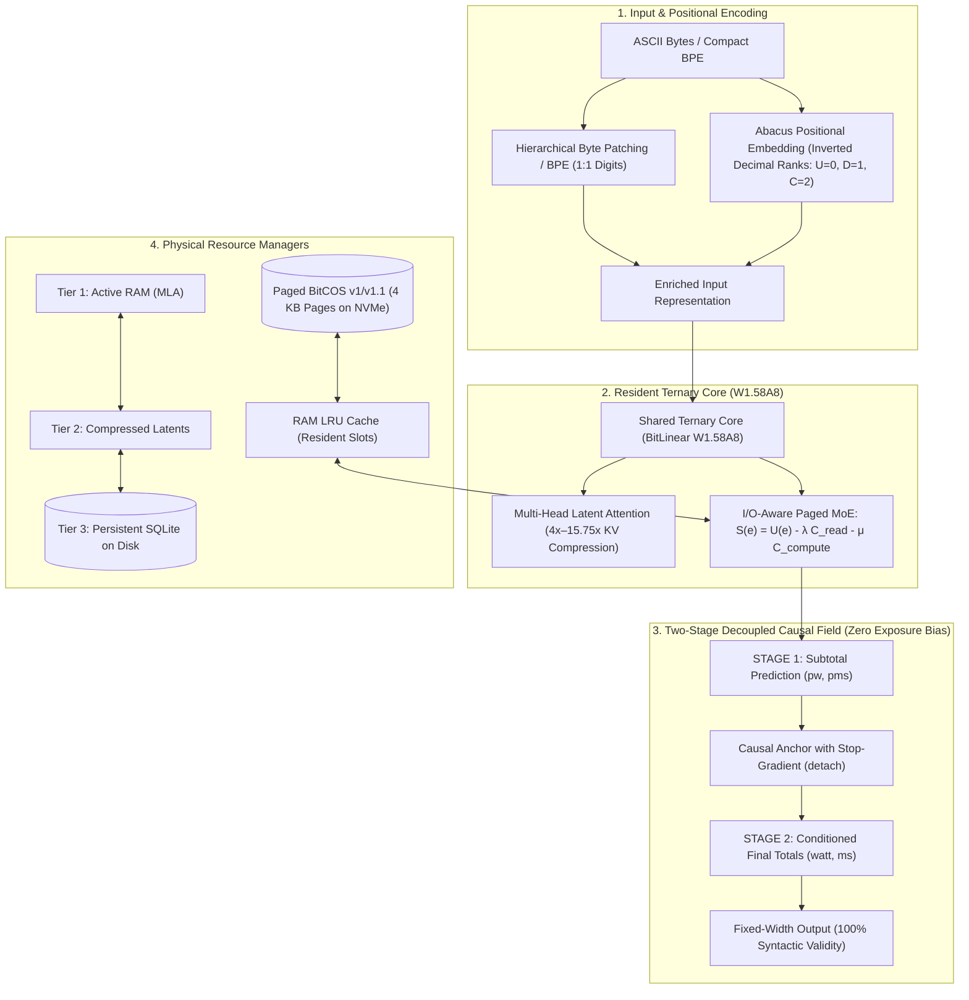
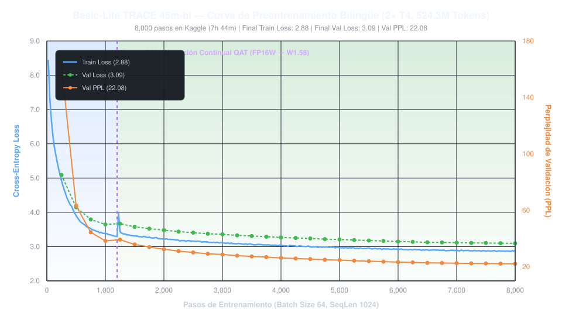

# Basic-Lite TRACE: Selective-Residency W1.58A8 Inference Engine for Consumer CPUs

> **Language / Idioma:** **English** | [Español](README.es.md)


[](https://github.com/Miguel19x/Basic-Lite-TRACE/actions/workflows/ci.yml)

**Basic-Lite TRACE** (*Ternary Resident Architecture for Convergent Execution*) is an ultra-low-precision (**W1.58A8**) neural architecture and standalone C inference engine created and led by **Miguel19x**. Its long-term architectural goal is to decouple total model capacity stored on NVMe (projected toward **30B parameters**) from active resident RAM on standard consumer hardware (**Intel Core i3-1115G4**, 2 physical cores / 4 threads, 16 GB RAM, NVMe SSD, Linux x86_64), without a dedicated GPU and without inflating full weight matrices to FP32 in RAM.

The design is governed by **selective residency and execution**: storing 4 KB OS-page-aligned ternary weights on disk (`Paged BitCOS`) and executing directly over packed binary pages via AVX2/FMA C kernels under pre-registered, reproducible experimental protocols.

---

## 1. The TRACE Architecture and Convergence Pillars

* **Ternary (100% W1.58A8 Preserved):**  
  All core linear projections operate with strict ternary weights $\{-1, 0, 1\}$ via [trace/layers/bitlinear.py](trace/layers/bitlinear.py) using Straight-Through Estimation (STE). At runtime, packed binary pages execute directly without FP32 weight expansion in RAM through native C kernels ([csrc/paged_dispatch.c](csrc/paged_dispatch.c), [csrc/paged_gemm_avx2.c](csrc/paged_gemm_avx2.c)) and [Paged BitCOS v1](trace/serialization/paged_bitcos.py).

* **Resident / Recursive (Selective Residency & Dynamic Recursion):**  
  The shared resident core ([trace/modules/resident_core.py](trace/modules/resident_core.py)) iterates $R$ recursion steps over a dual latent state (deep reasoning $z_r$ and response $y_r$) with sinusoidal depth encoding $e_r$ and an adaptive halting gate.

* **Convergent / Causal (Two-Stage Decoupled Causal Field):**  
  For compositional arithmetic (Phase 1–2), the **Two-Stage Decoupled Causal Field with `detach()`** ([trace/models/causal.py](trace/models/causal.py)) separates multiplicative subtotals ($P_w, P_{ms}$) from final sums ($watt, ms$). With the 2-stage BitNet b1.58 QAT schedule (v1.2.0-trace), Test-Compositional Full-EM reaches **$90.29\% \pm 13.44\%$** (peak **$98.96\%$** on Seed 456, Train-200 mean **$99.70\%$**), with **$100.00\%$** Scratchpad EM and **$0.61\%$** ECE.

---

## 2. Global Architecture Overview



---

## 3. Five Canonical Architectural Axes

1. **OS-Page-Aligned Binary Paging (`Paged BitCOS v1 / v1.1`):** Direct storage reads (`O_DIRECT` + `pread`) aligned to **4096-byte Linux memory pages** with AVX2/FMA C micro-kernels, bypassing OS page-cache duplication and avoiding FP32 weight inflation ([trace/serialization/paged_bitcos.py](trace/serialization/paged_bitcos.py)).
2. **I/O-Aware Paged MoE Routing:** Dynamically penalizes non-resident experts via $S(e) = U(e) - \lambda C_{\text{read}}(e) - \mu C_{\text{compute}}(e)$ with *buddy expert* fallback under strict latency budgets ([trace/modules/paged_moe.py](trace/modules/paged_moe.py)).
3. **Multi-Head Latent Attention (MLA) & 3-Tier Context Memory:** Joint KV latent compression ([trace/lm/mla.py](trace/lm/mla.py), **4×–8×** in FP32, **15.75×** in INT8 KV) paired with a 3-tier context manager: Active RAM, Compressed Latents, and SQLite FTS5 persistent storage ([trace/core/context_manager.py](trace/core/context_manager.py)).
4. **Compact Byte/BPE Tokenization:** Evolved from raw ASCII bytes (260 tokens, Phase 1–2) to a native C compact BPE tokenizer ([csrc/lm/trace_tokenizer.c](csrc/lm/trace_tokenizer.c), [trace/lm/tokenizer.py](trace/lm/tokenizer.py), 4K–8K vocabulary, 1:1 digit preservation, tied embeddings) in Phase 3.
5. **Abacus Embeddings & Two-Stage Causal Field:** Vectorized right-to-left decimal rank embeddings ([trace/layers/abacus.py](trace/layers/abacus.py)) + stop-gradient (`detach()`) causal anchoring ([trace/models/causal.py](trace/models/causal.py)) + Staged Warmup curriculum ([train.py](train.py)).

---

## 4. Empirical Results & Hardware Benchmarks

### 4.1. Phase 1 Consolidated Results (v1.2.0-trace — 5 Seeds, BitNet b1.58 QAT Schedule)
Evaluated across 5 fixed seeds (`42, 123, 456, 789, 999`) at step 6000 on CPU (2 threads, i3-1115G4), logged in [results/eval_fase1_bitnet_5semillas_results.json](results/eval_fase1_bitnet_5semillas_results.json):

| Metric | Phase 2b (Baseline) | **Phase 1 (BitNet QAT Schedule, v1.2.0)** | Delta |
| :--- | :---: | :---: | :---: |
| **Test-Comp Full Exact Match (Full-EM)** | $19.04\% \pm 22.73\%$ (Median: $8.75\%$) | **$90.29\% \pm 13.44\%$** (Median: **$95.21\%$**) | **+71.25 pp** |
| **Scratchpad EM ($P_w, P_{ms}$)** | $98.21\% \pm 1.01\%$ | **$100.00\% \pm 0.00\%$** (480/480 across 5 seeds) | **+1.79 pp** |
| **Isolated Digit Accuracy** | $88.20\% \pm 5.61\%$ | **$98.94\% \pm 1.58\%$** | **+10.74 pp** |
| **Train-200 Full-EM (without replacement)** | $24.90\% \pm 26.23\%$ | **$99.70\% \pm 0.27\%$** | **+74.80 pp** |
| **DEV Full-EM (108 cases)** | $21.67\% \pm 25.64\%$ | **$94.81\% \pm 10.07\%$** | **+73.14 pp** |
| **Test-Random Full-EM (240 cases)** | $19.58\% \pm 22.84\%$ | **$94.58\% \pm 8.18\%$** | **+75.00 pp** |
| **Test-Comp ECE Calibration** | *Not logged* | **$0.61\%$** (Stage 2: $1.22\%$) | **Well-calibrated** |

```text
[Seed  42] Test-Comp: EM = 94.17% (452/480) | SP-EM = 100.00% | ECE = 0.37% | DEV: EM =  98.15%
[Seed 123] Test-Comp: EM = 66.46% (319/480) | SP-EM = 100.00% | ECE = 2.01% | DEV: EM =  76.85%
[Seed 456] Test-Comp: EM = 98.96% (475/480) | SP-EM = 100.00% | ECE = 0.06% | DEV: EM = 100.00%
[Seed 789] Test-Comp: EM = 95.21% (457/480) | SP-EM = 100.00% | ECE = 0.35% | DEV: EM = 100.00%
[Seed 999] Test-Comp: EM = 96.67% (464/480) | SP-EM = 100.00% | ECE = 0.25% | DEV: EM =  99.07%
------------------------------------------------------------------------------------------------
Global Mean  : Test-Comp: EM = 90.29% ± 13.44% (95% Bootstrap CI: [78.04%, 97.29%])
Scratchpad EM: Test-Comp: EM = 100.00% ± 0.00% (480/480 across all 5 seeds)
```

*(Historical pre-registered v1.0.0 baseline: Test-Comp Full-EM $5.12\% \pm 4.88\%$, Scratchpad EM $81.88\% \pm 10.14\%$; see [results/eval_confirmatorio_5semillas_results.json](results/eval_confirmatorio_5semillas_results.json)).*

### 4.2. Current Status & Phase 3 Consolidated Results (v1.4.0-trace — Milestone 3.7: Bilingual `45m-bi` W1.58 LM & Standalone C Engine)

**Milestone 3.7** completes Phase 3 with a 100% ternary W1.58 bilingual (EN/ES) autoregressive language model (**`45m-bi`**, **47.2M parameters**) pretrained on Kaggle (`2× NVIDIA Tesla T4`, DDP) for 8,000 steps (**524.3M tokens**) and exported to `Paged BitCOS v1.1` (**31.02 MB** binary, 2,716 4 KB pages, Python $\to$ C export parity `max_diff` $= 3.34 \times 10^{-6}$; full report in [docs/HITO_3_7_BENCHMARKS.md](docs/HITO_3_7_BENCHMARKS.md) and 25M system benchmark in [docs/FASE3_BENCHMARK.md](docs/FASE3_BENCHMARK.md)).

- **Model Dimensions:** $L=14$, $d_{\text{model}}=640$, $d_{\text{ff}}=1280$ (Squared-ReLU), $n_{\text{heads}}=10$, MLA $d_c=160$, $d_h=64$, $d_{pe}=32$, $V=8,192$ BPE tied embeddings.
- **Distributed Pretraining (Kaggle `2× T4`, 7h 43m 03s):** Continual QAT (FP16W warmup steps 1–1200 $\to$ strict W1.58 STE steps 1201–8000) converging to $\text{Train Loss} = 2.88$, $\text{Val Loss} = 3.09$, **$\text{Val PPL} = 22.08$**.



#### Standalone CPU Performance (`Intel Core i3-1115G4`, 2 physical cores, `OMP_NUM_THREADS=2`)
Measured with `/usr/bin/time -v ./trace_lm` over 100 generated tokens:

| ISA Dispatch | KV Cache Mode | Greedy TTFT (ms) | Greedy Throughput (tok/s) | Sampling Throughput (tok/s) | Peak RAM (Max RSS) | Speedup vs Scalar |
| :--- | :---: | :---: | :---: | :---: | :---: | :---: |
| **AVX2 + FMA** | **INT8 KV** (default) | **16.94 ± 2.17 ms** | **214.53 ± 27.31 tok/s** | **162.81 tok/s** | **36.22 MB** | **8.11× / 20.49× TTFT** |
| **AVX2 + FMA** | **FP32 KV** (`--no_int8_kv`) | **18.17 ± 1.90 ms** | **237.26 ± 10.78 tok/s** | **171.48 tok/s** | **36.66 MB** | **9.76× / 20.79× TTFT** |
| **Scalar C99** | **INT8 KV** | 347.09 ± 69.78 ms | 26.47 ± 3.48 tok/s | 20.89 tok/s | 36.22 MB | Scalar INT8 Baseline |
| **Scalar C99** | **FP32 KV** | 377.73 ± 74.55 ms | 24.30 ± 0.17 tok/s | 24.91 tok/s | 36.89 MB | Scalar FP32 Baseline |

#### Quick Reproduction Commands
```bash
# 1. Build standalone native C engine & kernels (GCC + OpenMP + AVX2)
OMP_NUM_THREADS=2 make clean && make all

# 2. English inference (greedy)
./trace_lm --prompt "Once upon a time, a curious engineer" --temp 0.0 --max_tokens 30

# 3. Spanish inference (Top-P sampling + repetition penalty)
./trace_lm --prompt "El algoritmo de inferencia profunda" --temp 0.7 --top_p 0.9 --rep_pen 1.15 --max_tokens 35
```

---

## 5. Architecture Decision Record (ADR)

| Architectural Decision | Technical Rationale | Validated Advantage | Trade-Off |
| :--- | :--- | :--- | :--- |
| **Paged BitCOS v1 (4 KB)** | Direct `O_DIRECT` execution without inflating layers to FP32. | 1.58-bit weights; OS-page-aligned disk reads. | Requires matrix packing aligned to 4 KB multiples. |
| **I/O-Aware MoE Router** | Prevent PCIe/NVMe saturation from indiscriminate expert swaps. | Reduces physical disk transfers by favoring RAM-resident experts. | Requires tuning $\lambda_{\text{read}}$ and *buddy expert* fallbacks. |
| **Multi-Head Latent Attention** | Shrink active KV cache retained in working RAM. | 4×–15.75× KV RAM reduction (FP32 / INT8). | Adds linear decompression projection at inference. |
| **Abacus Embeddings** | Give ASCII numeric tokens explicit decimal place-value symmetry. | Boosts isolated digit accuracy from 60.5% to >81.9% (98.94% in v1.2). | Requires vectorized reverse cumulative rank indexing. |
| **Two-Stage Causal Field** | Eliminate Exact Match collapse under parallel factorization. | Scales Test-Comp Full-EM from 0% to 90.29% ± 13.44% (peak 98.96%). | Requires two forward passes at inference. |
| **Staged Warmup Curriculum** | Prevent noisy Stage 1 outputs from corrupting Stage 2 addition. | Stable convergence under scheduled sampling. | Requires calibrating warmup ratio ($40\%$ of steps). |

---

## 6. Repository Structure

```
.
├── .github/                                  # CI automation & GitHub governance templates
│   ├── ISSUE_TEMPLATE/                       # Privacy & security-aware issue templates
│   ├── PULL_REQUEST_TEMPLATE.md              # PR policy & single-ownership notice
│   └── workflows/
│       └── ci.yml                            # GitHub Actions CI (Ubuntu, Ruff, GCC, pytest)
├── csrc/                                     # Modular native C engine (O_DIRECT, AVX2/FMA, OpenMP)
│   ├── lm/                                   # Autoregressive LM C engine (BPE, MLA, INT8 KV, trace_lm)
│   ├── paged_dispatch.{c,h}                  # Dynamic scalar / AVX2 dispatch for ternary GEMM
│   ├── paged_gemm_avx2.c                     # AVX2 Add-Sub ternary GEMM micro-kernel
│   ├── paged_gemm_scalar.c                   # Portable C99 reference micro-kernel
│   ├── paged_unpack.h                        # Paged BitCOS v1 page unpacker
│   ├── trace_infer.h / trace_math.h          # Canonical headers & SIMD math routines
│   ├── trace_loader.c                        # 4096-byte aligned O_DIRECT weight loader
│   └── trace_causal.c                        # Two-stage causal pipeline & standalone CLI (trace_infer)
├── config.py / data.py                       # Unified hyperparameters & procedural dataset generator
├── train.py / eval.py                        # BitNet b1.58 QAT training & 2-stage evaluation
├── export_paged.py / export_paged_lm.py      # PyTorch -> Paged BitCOS v1 / v1.1 exporters
├── requirements.txt / Makefile               # CPU dependencies & full C/test build automation
├── LICENSE.txt / LICENSE-EN.md               # Binding Source-Available license (ES) & reference (EN)
├── CONTRIBUTING.md / CODE_OF_CONDUCT.md      # 3-channel SQLite-style contribution model & conduct
├── NOTICE.md / AUTHORS.md                    # Project notice, authorship & scientific credits
├── CHANGELOG.md / SECURITY.md                # Release history & responsible disclosure policy
├── THIRD_PARTY_NOTICES.md                    # Third-party open-source attributions (BSD-3, MIT, PD)
├── Protocolo pre-registrado — Basic-Lite...  # Frozen Phase 1 pre-registered experimental protocol
├── results/                                  # Confirmatory multi-seed JSONs & benchmark artifacts
├── docs/                                     # Technical docs, roadmaps, provenance & cryptography
│   ├── PROJECT_IDENTITY.md                   # Technical identity & TRACE convergence history
│   ├── PROVENANCE.md                         # Provenance inventory & chain of custody
│   ├── RELEASE_MANIFEST.md (+ .tsq / .tsr)   # SHA-256 manifest & external RFC 3161 timestamp
│   ├── AI_ASSISTANCE.md                      # AI tool disclosure & human authorship boundaries
│   ├── PAPER_TECNICO_BASIC_LITE.md           # Foundational technical paper
│   ├── FASE3_BENCHMARK.md                    # Phase 3 CPU inference benchmark report (25M)
│   ├── HITO_3_7_BENCHMARKS.md                # Milestone 3.7 bilingual 45m-bi pretraining report
│   └── ROADMAP_TRACE.md / ROADMAP_POST_FASE5.md # Engineering roadmaps
├── scripts/ / notebooks/                     # LM corpus, training, benchmarking & GPU pilot notebooks
├── tests/                                    # Verification suites (AVX2, O_DIRECT, parity, MLA, E0)
├── trace/                                    # Canonical Python package
│   ├── core/                                 # 3-tier context manager (RAM/Latent/SQLite FTS5) & types
│   ├── layers/                               # Abacus, BitLinear W1.58A8, FFN, RMSNorm, RoPE, Embeddings
│   ├── lm/                                   # TRACELanguageModel, ternary MLA, config & BPE tokenizer
│   ├── modules/                              # Attention, PagedMoE & SharedResidentTernaryCore
│   ├── models/                               # TRACECausalModel (Two-Stage Causal Field)
│   ├── ops/                                  # ctypes bindings to libpaged_gemm.so & CPU ternary ops
│   └── serialization/                        # Paged BitCOS v1 / v1.1 reader/writer
└── licenses/                                 # Full third-party license texts
```

---

## 7. Quickstart

### 7.1. Environment Setup & Build
```bash
# 1. Create and activate virtual environment
python3 -m venv venv
source venv/bin/activate

# 2. Install CPU dependencies
pip install -r requirements.txt

# 3. Build native C engine and kernels (requires GCC with OpenMP & AVX2)
make all

# 4. Run test suites
make test
```

### 7.2. Local CPU Pilot Training (`Intel Core i3`)
```bash
python train.py --steps 1000 --batch_size 32 --warmup_ratio 0.40 --device cpu
```

> [!NOTE]
> Binary checkpoints (`*.pt`, `*.bin`) are excluded via `.gitignore`. Checkpoints can be generated locally or tracked per version in [GitHub Releases](https://github.com/Miguel19x/Basic-Lite-TRACE/releases) (latest published release: `v1.3.0-trace`; `v1.0.0-trace` artifacts are historical and structurally incompatible with `v1.2.0+`).

---

## 8. Collaboration Model & Core Team

Basic-Lite TRACE is published under a **Source-Available** license to enable rigorous scientific scrutiny, teaching, and legitimate technical evaluation while reserving commercial exploitation.

Following an **SQLite-style governance model**, the core repository does not merge unsolicited external pull requests without a prior bilateral agreement (preserving clean IP provenance and architectural coherence), while offering **three active collaboration channels** (see [CONTRIBUTING.md](CONTRIBUTING.md)):

* **Community Hardware Benchmarks (Issues):** Run `make all` / `./trace_lm` on other CPUs (AMD Ryzen, Intel AVX-512, ARM64 / Apple Silicon) and share reproducible latency and RAM metrics.
* **Bug Reports & Technical Diagnostics (Issues):** Report defects or profile bottlenecks (e.g., cold-prefill optimization in `csrc/lm/trace_lm_infer.c`).
* **Core Team (Bilateral Agreement):** Looking for long-term collaborators in **C / SIMD / Linux Systems** (AVX2/AVX-512/NEON, `O_DIRECT`/`io_uring`) and **ML Scaling (PyTorch)**. The best way to start is by opening a high-signal technical Issue or writing to `miguelaranguren19x@outlook.com`.

---

## 9. Ownership, Intellectual Property & Governance

* **Sole Author & Rights Holder:** Miguel19x (`miguelaranguren19x@outlook.com`)
* **License:** [LICENSE.txt](LICENSE.txt) (binding Spanish Source-Available license; research, teaching, and 30-day PoC with prior written notice; commercial/SaaS and commercial AI training/distillation reserved) · English reference translation: [LICENSE-EN.md](LICENSE-EN.md)
* **Governance & Policies:** [NOTICE.md](NOTICE.md) · [CONTRIBUTING.md](CONTRIBUTING.md) · [CODE_OF_CONDUCT.md](CODE_OF_CONDUCT.md) · [SECURITY.md](SECURITY.md) · [AUTHORS.md](AUTHORS.md) · [CHANGELOG.md](CHANGELOG.md)
* **Third-Party Licenses:** [THIRD_PARTY_NOTICES.md](THIRD_PARTY_NOTICES.md) & [licenses/](licenses/)
* **Provenance & Cryptographic Integrity:** [docs/PROVENANCE.md](docs/PROVENANCE.md) · [docs/RELEASE_MANIFEST.md](docs/RELEASE_MANIFEST.md) (with external RFC 3161 timestamp `docs/RELEASE_MANIFEST.md.tsr`) · [docs/AI_ASSISTANCE.md](docs/AI_ASSISTANCE.md)

---

## 10. Citation & Commercial Licensing

```bibtex
@misc{miguel19x2026basiclitetrace,
  author = {Miguel19x},
  title = {Basic-Lite TRACE: Ternary Resident Architecture for Convergent Execution on Consumer CPUs},
  year = {2026},
  publisher = {GitHub},
  howpublished = {\url{https://github.com/Miguel19x/Basic-Lite-TRACE}}
}
```

For **commercial licensing**, **30-day PoC start notifications**, or **custom C/SIMD deployment consulting**, contact:  
**Miguel19x** — `miguelaranguren19x@outlook.com`
