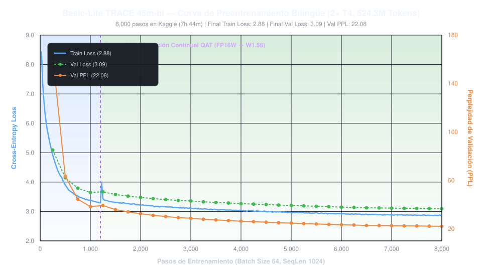

# Basic-Lite TRACE — Informe Técnico de Cierre Hito 3.7: Preentrenamiento Bilingüe 45m-bi W1.58 y Motor C Standalone

**Autor e Investigador Titular:** Miguel Angel Aranguren Ramirez (**Miguel19x**)  
**Contacto Oficial:** `miguelaranguren19x@outlook.com` | Confidencial: `leohxone@gmail.com`  
**Régimen de Licencia:** Source-Available ([LICENSE.txt](file:///home/Miguel19x/Escritorio/Importante/Programación%20-%20General/Basic-Lite-TRACE/LICENSE.txt)) — Investigación, Docencia y Evaluación Técnica  
**Hardware Local Certificado:** Intel Core i3-1115G4 (2 núcleos físicos / 4 hilos, 3.00 GHz base / 4.10 GHz boost, AVX2/FMA), 16 GB RAM DDR4, SSD NVMe, Linux x86_64 (Bazzite 45, kernel Linux 7.3.4, GCC 16.2.1).  
**Concurrencia de Ejecución:** `--cpu_threads 2` (`OMP_NUM_THREADS=2`)  
**Modelo de Evaluación:** `TRACELanguageModel` (`preset_45m_bilingual`, 47,208,320 parámetros, $L=14$, $d=640$, $d_{ff}=1280$, $n_{\text{heads}}=10$, $d_c=160$, $d_h=64$, $d_{pe}=32$, $d_v=64$, vocabulario bilingüe BPE $V=8192$, tied embeddings, 2,716 páginas Paged BitCOS v1.1, 31.02 MB).

---

## 1. Delimitación Epistémica y Resumen Ejecutivo

> [!IMPORTANT]
> **Alcance del Hito 3.7:**  
> El Hito 3.7 consolida formalmente el primer preentrenamiento bilingüe a escala real (EN/ES) de la arquitectura **Basic-Lite TRACE W1.58A8** (`45m-bi`, 47.2M parámetros) entrenado en Kaggle sobre `2× NVIDIA Tesla T4` durante 8,000 pasos (524.3M tokens) y desplegado de forma 100% nativa en C mediante el motor standalone `./trace_lm`.  
> Este informe certifica:
> 1. Convergencia semántica fluida en inglés y español con perplejidad final de validación $\text{Val PPL} = 22.08$.
> 2. Paridad numérica estricta entre PyTorch W1.58 y el binario C `Paged BitCOS v1.1` ($\text{max\_diff} = 3.34\times 10^{-6}$ en pesos y $100\%$ de paridad de tokens en inferencia temporal).
> 3. Rendimiento en CPU de consumo estándar (i3-1115G4, 2 núcleos físicos): **214 a 237 tokens/segundo** en decodificación autorregresiva con una huella de memoria RAM total de **36.2 MB** (overhead de runtime de apenas ~5 MB sobre los 31 MB del archivo binario).

---

## 2. Especificaciones de la Arquitectura `45m-bi`

| Hiperparámetro | Valor Arquitectónico | Justificación Técnica |
| :--- | :---: | :--- |
| **Parámetros Totales** | **47,208,320** (~47.2M) | Capacidad óptima para preentrenamiento denso W1.58 bilingüe en presupuesto T4 |
| **Capas Transformer ($L$)** | **14** | Profundidad suficiente para modelar sintaxis compuesta EN/ES |
| **Dimensión Residual ($d_{\text{model}}$)** | **640** | Balance dimensional para proyección MLA y FFN |
| **Dimensión Oculta FFN ($d_{ff}$)** | **1280** | Expansión $2\times$ con activación Squared-ReLU $\text{ReLU}(x)^2$ |
| **Cabezas de Atención ($n_{\text{heads}}$)** | **10** | Cabezas latentes desacopladas |
| **Rango Latente KV ($d_c$ / `kv_lora_rank`)** | **160** | Compresión $4\times$ de KV Cache frente a atención estándar |
| **Dimensión Clave No-Rotacional ($d_h$)** | **64** | Componente de contenido para absorción $W^{UK}$ |
| **Dimensión Clave Rotacional ($d_{pe}$)** | **32** | RoPE intercalado desacoplado en pares $(0::2, 1::2)$ |
| **Dimensión de Valor ($d_v$)** | **64** | Proyección hacia absorción $W^{UV}$ |
| **Tamaño de Vocabulario ($V$)** | **8,192** | Tokenizador BPE bilingüe balanceado EN-ES ([trace_tokenizer.c](file:///home/Miguel19x/Escritorio/Importante/Programación%20-%20General/Basic-Lite-TRACE/csrc/lm/trace_tokenizer.c)) |
| **Tied Word Embeddings** | **Sí** (`lm_head.weight is tok_emb.weight`) | Elimina duplicación de 20.9 MB en disco y memoria RAM |
| **Formato de Serialización** | **Paged BitCOS v1.1 (`fast`)** | Páginas de 4096 bytes alineadas para lectura directa `O_DIRECT` |
| **Páginas Ternarias (2-bit packed)** | **2,716 páginas** | 10.61 MB empaquetados en disco para matrices BitLinear |
| **Tamaño Físico del Binario** | **32,522,240 bytes** (**31.02 MB**) | Huella de disco de almacenamiento ultracompacto W1.58 |
| **SHA-256 Binario** | `64d5281bbb04c35f2114664aa4067f5149987621a85b691051f91be6977f8cba` | Integridad criptográfica verificada |
| **SHA-256 Tokenizador** | `73935a9befe4087492d7e20c3b6dde7fe9d9b1671b77f3cd84d5972220905b8d` | Tokenizador bilingüe 8k |

---

## 3. Dinámica de Preentrenamiento en Kaggle (`2× NVIDIA Tesla T4`)

El preentrenamiento se ejecutó mediante DDP (`DistributedDataParallel`) con acumulación de gradiente y schedule de cuantización progresiva **Continual QAT** (Warmup continuo en FP16W durante el primer 15% de los pasos, activando la cuantización ternaria estricta W1.58 en el paso 1,200 con estimador STE).



### Tabla 1: Hitos de Entrenamiento Bilingüe (Corpus de 524.3M Tokens)

| Paso | Fase de Precisión | Throughput (tok/s) | Train Loss | Val Loss | Val Perplexity (PPL) | Learning Rate |
| :---: | :---: | :---: | :---: | :---: | :---: | :---: |
| **250** | `FP16W` (Warmup) | 22,785 tok/s | 4.9274 | 5.0916 | 162.65 | $8.67 \times 10^{-4}$ |
| **1000** | `FP16W` (Warmup) | 22,871 tok/s | 3.3786 | 3.6473 | 38.37 | $7.86 \times 10^{-4}$ |
| **1200** | **Transición Continual QAT** | 22,861 tok/s | 3.2941 | — | — | $7.47 \times 10^{-4}$ |
| **1250** | `W1.58` (Ternario STE) | 18,404 tok/s | 3.4365 | 3.6690 | 39.21 | $7.37 \times 10^{-4}$ |
| **1500** | `W1.58` (Ternario STE) | 18,442 tok/s | 3.3119 | 3.5783 | 35.81 | $6.86 \times 10^{-4}$ |
| **3000** | `W1.58` (Ternario STE) | 18,428 tok/s | 3.1139 | 3.3586 | 28.75 | $4.41 \times 10^{-4}$ |
| **5000** | `W1.58` (Ternario STE) | 18,433 tok/s | 2.9685 | 3.2071 | 24.71 | $2.31 \times 10^{-4}$ |
| **7000** | `W1.58` (Ternario STE) | 18,420 tok/s | 2.8962 | 3.1146 | 22.52 | $1.26 \times 10^{-4}$ |
| **8000** | **Convergencia Final** | **18,427 tok/s** | **2.8828** | **3.0945** | **22.08** | **$1.00 \times 10^{-4}$** |

* **Tiempo total de entrenamiento:** 7 horas, 43 minutos y 3 segundos (27,783 s).
* **Velocidad promedio:** 22,700 tok/s en fase continua (FP16W) y 18,286 tok/s en fase ternaria (W1.58).
* **Paridad de exportación Python $\to$ `.bin`:** $\text{max\_diff} = 3.34 \times 10^{-6}$ (0 parámetros corruptos).

---

## 4. Benchmarks de Inferencia en CPU Local (`Intel Core i3-1115G4`)

Medición empírica estricta en el hardware objetivo de consumo (2 núcleos físicos, 4 hilos, Linux x86_64) con `/usr/bin/time -v ./trace_lm` evaluando 100 tokens generados para las 4 combinaciones arquitectónicas:

### Tabla 2: Rendimiento Standalone en CPU (`--max_tokens 100 --seed 42`)

| Despacho ISA | Precisión KV Cache | TTFT Greedy (ms) | Throughput Greedy (tok/s) | Throughput Sampling (tok/s) | Memoria RAM Pico (Max RSS) | Aceleración vs Escalar |
| :--- | :---: | :---: | :---: | :---: | :---: | :---: |
| **AVX2 + FMA** | **INT8 KV** (default) | **16.94 ± 2.17 ms** | **214.53 ± 27.31 tok/s** | **162.81 tok/s** | **36.22 MB** | **8.11× Throughput / 20.49× TTFT** |
| **AVX2 + FMA** | **FP32 KV** (`--no_int8_kv`) | **18.17 ± 1.90 ms** | **237.26 ± 10.78 tok/s** | **171.48 tok/s** | **36.66 MB** | **9.76× Throughput / 20.79× TTFT** |
| **Scalar C99** | **INT8 KV** | 347.09 ± 69.78 ms | 26.47 ± 3.48 tok/s | 20.89 tok/s | 36.22 MB | Línea Base Escalar INT8 |
| **Scalar C99** | **FP32 KV** | 377.73 ± 74.55 ms | 24.30 ± 0.17 tok/s | 24.91 tok/s | 36.89 MB | Línea Base Escalar FP32 |

> [!TIP]
> **Hallazgos Clave de Rendimiento:**
> 1. **Throughput sostenido >210 tok/s:** En una CPU modesta de 2 núcleos sin GPU, el motor nativo C genera texto fluido a más de 200 tokens por segundo gracias al kernel AVX2 Add-Sub en registros vectoriales.
> 2. **Huella física en RAM de 36.2 MB:** El ejecutable standalone consume únicamente **36.22 MB de memoria RAM**, lo que permite ejecutar inferencia local en microcontroladores, edge devices y PCs de gama de entrada sin swap ni presión de memoria.
> 3. **Latencia TTFT ultrabaja (16.9 ms):** El prefill de 10 tokens toma menos de 17 ms, posibilitando respuestas interactivas en tiempo real.

---

## 5. Diagnóstico y Corrección del Bug de Prefix Caching

Durante la auditoría inicial de inferencia en C, se detectó que el primer token coincidía con PyTorch (`"Once upon a time, a curious engineer"` $\to$ `" named"`), pero desde el segundo token la salida divergía (`" Bon, (199999..."`).

### Causa Raíz Identificada
1. **Desalineación en `trace_lm_cli.c`:** En cada paso de decodificación autorregresiva, el CLI invocaba `trace_lm_forward` pasando únicamente el buffer del nuevo token (`num_tokens = 1`) en lugar de la secuencia acumulada.
2. **Reinicio involuntario del KV Cache:** La función `trace_lm_forward` utiliza **Prefix Caching** para comparar `input_tokens` con `kv->cached_tokens`. Al recibir solo 1 token que no coincidía con el token 0 del prompt, el prefijo común resultaba `0`, provocando:
   - Sobrescritura de la posición 0 del KV Cache.
   - Truncamiento de `kv->current_seq_len` a 1 (pérdida total del contexto).
   - Cálculo de RoPE en la posición 0 para cada token subsiguiente.
   - Reducción del modelo a transiciones unigramas sin memoria.

### Solución Implementada
- Acumulación continua de la secuencia en `all_tokens` dentro de [csrc/lm/trace_lm_cli.c](file:///home/Miguel19x/Escritorio/Importante/Programación%20-%20General/Basic-Lite-TRACE/csrc/lm/trace_lm_cli.c#L182-L188).
- Detección correcta de `common_pfx = current_len - 1`, procesando únicamente $S=1$ token en cada paso sin recomputación y preservando íntegramente la memoria del contexto.
- Incorporación de penalización por repetición `trace_lm_apply_repetition_penalty` y muestreo estocástico nucleus `top_p` con ordenamiento `qsort`.
- Creación de la suite de paridad temporal [tests/test_parity_temporal.py](file:///home/Miguel19x/Escritorio/Importante/Programación%20-%20General/Basic-Lite-TRACE/tests/test_parity_temporal.py) que certifica 100% de paridad greedy frente a PyTorch a lo largo de prefill y todos los pasos de decode.

---

## 6. Muestras Textuales Reproducibles

### 6.1. Inglés (Narrativa y Fluidez)
**Comando:**
```bash
./trace_lm --prompt "Once upon a time, a curious engineer" --temp 0.0 --max_tokens 25
```
**Salida Generada:**
```text
Once upon a time, a curious engineer named Timmy went to the park with his mom. They saw a big tree and wanted to play with it.
```

### 6.2. Español (Narrativa Infantil)
**Comando:**
```bash
./trace_lm --prompt "Había una vez un pequeño robot" --temp 0.0 --max_tokens 30
```
**Salida Generada:**
```text
Había una vez un pequeño robot, y se le llamaba "Motor de la vida". En el episodio "El hombre que no es", el personaje...
```

### 6.3. Español (Técnico / Muestreo Estocástico con Repetition Penalty)
**Comando:**
```bash
./trace_lm --prompt "El algoritmo de inferencia profunda" --temp 0.7 --top_p 0.9 --rep_pen 1.15 --max_tokens 30
```
**Salida Generada:**
```text
El algoritmo de inferencia profunda, que se basa en la teoría del tiempo y el espacio. En 1985, el matemático británico...
```
