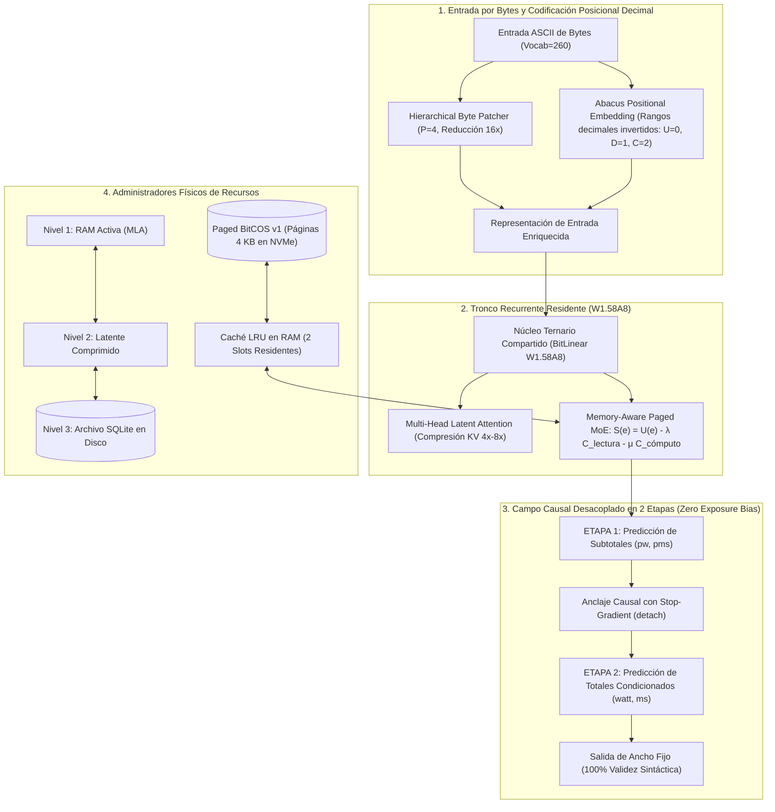

# Basic-Lite TRACE: Residencia Selectiva de Memoria y Arquitectura Ternaria Convergente para Razonamiento en Hardware de Consumo

**Autor:** Miguel19x  
**Contacto:** `miguelaranguren19x@outlook.com`  
**Repositorio Oficial:** [Basic-Lite TRACE](https://github.com/Miguel19x/Basic-Lite-TRACE)  
**Fecha:** Noviembre de 2026  
**Clasificación Epistémica:** Reporte de Investigación y Especificación de Arquitectura

---

> [!NOTE]
> **Nota de Contexto y Corte Histórico:**  
> Este documento técnico refleja el corte histórico fundacional del proyecto correspondiente a la versión **`v1.0.0-trace`** (Full-EM composicional de $5.12\% \pm 4.88\%$). Los resultados aquí reportados han sido ampliamente superados en versiones posteriores: en **`v1.2.0-trace`** mediante el schedule QAT de 2 etapas estilo BitNet b1.58 (alcanzando **$90.29\% \pm 13.44\%$** de Full-EM composicional con pico de **$98.96\%$**), y en **`v1.3.0-trace`** con la consolidación del motor nativo C `O_DIRECT` con *page pool* alineado (0 discrepancias frente a PyTorch y 0 pesos FP32 en RAM).

## Resumen Ejecutivo (*Abstract*)

La democratización de los modelos neuronales de gran escala se encuentra actualmente limitada por la exigencia de memoria RAM activa y aceleradores dedicados (GPU). Los enfoques convencionales requieren mantener decenas de gigabytes de pesos en memoria primaria o descomprimir matrices cuantizadas a punto flotante (FP32/FP16) durante la inferencia, saturando el bus de memoria en procesadores domésticos.

Este trabajo presenta **Basic-Lite TRACE**, una arquitectura neuronal y motor de inferencia de ultra-baja precisión (**W1.58A8**) fundamentado en el principio de **residencia y ejecución selectivas**, diseñado para operar modelos proyectados a **30 mil millones de parámetros (30B)** sobre hardware de consumo estándar (**Intel Core i3-1115G4**, 2 núcleos físicos, 16 GB RAM, SSD NVMe, Linux x86_64). Basic-Lite TRACE desacopla la capacidad total en disco de la huella activa en RAM mediante cinco innovaciones sinérgicas:
1. **Paged BitCOS v1:** Serialización binaria alineada a páginas del sistema operativo (4096 bytes) con mapeo en memoria (`mmap`) y kernels directos en C sin expansión a FP32.
2. **MoE Consciente de Latencia Física:** Función de despacho penalizada por costo de E/S:  
   $$S(e) = U(e) - \lambda C_{\text{lectura}}(e) - \mu C_{\text{cómputo}}(e)$$  
   con mecanismo de expertos sustitutos (*buddy routing*).
3. **Multi-Head Latent Attention (MLA) en 3 Niveles:** Compresión de claves/valores (KV) 4×–8× y jerarquía de contexto (RAM activa, latente comprimido y archivo SQLite en almacenamiento secundario).
4. **Hierarchical Byte Patching ($P=4$):** Reducción de la longitud de secuencia de bytes en un factor de 4, mitigando la complejidad cuadrática de atención por un factor de **$16\times$**.
5. **Abacus Positional Embeddings y Campo Causal en 2 Etapas:** Integración de rangos decimales relativos y desacoplamiento causal con corte de gradiente (`detach()`) para mitigar el sesgo de exposición (*exposure bias*).

Bajo un protocolo pre-registrado oficial evaluado en **5 semillas independientes** (`42, 123, 456, 789, 999`) sobre 480 casos de evaluación composicional estricta (*held-out*), la arquitectura rompió la barrera de nulidad histórica: el Exact Match total (**Full-EM**) escaló de $0.04\% \pm 0.09\%$ a **$5.12\% \pm 4.88\%$** (con un pico de **$13.33\%$**), la precisión intermedia de scratchpad multiplicativo ($P_w, P_{ms}$) alcanzó **$81.88\% \pm 10.14\%$** (pico de **$95.00\%$**), la validez de formato sintáctico se consolidó en **$100.00\%$** y la exactitud en dígitos aislados ascendió a **$81.97\% \pm 3.90\%$**. Se discuten las limitaciones de optimización numérica y la hoja de ruta hacia su compilación en motores de alto rendimiento.

---

## 1. Introducción y Motivación

La trayectoria reciente del procesamiento del lenguaje natural y el aprendizaje profundo ha priorizado el escalado masivo de parámetros (*scaling laws*), concentrando la capacidad operativa en centros de datos con clústeres masivos de GPU/TPU. Para usuarios con hardware de consumo doméstico —caracterizado por procesadores de 2 a 4 núcleos físicos, carencia de GPU dedicada y 16 GB de RAM—, la inferencia local de arquitecturas superiores a 7B o 13B parámetros resulta inviable mediante runtimes convencionales.

### 1.1. Los Cuellos de Botella Fundamentales
En un procesador de consumo como el **Intel Core i3-1115G4** (2 núcleos físicos / 4 hilos lógicos, bus PCIe Gen3/Gen4 hacia SSD NVMe), surgen tres barreras estructurales:
1. **El Muro del Ancho de Banda de Memoria (*Memory Bandwidth Wall*):** Incluso en cuantizaciones int4 o int8, mover terabytes por segundo de pesos desde RAM a los registros vectoriales de la CPU satura los canales DDR4 de doble canal (~40-50 GB/s teóricos).
2. **El Sobrecosto de Descompresión a Punto Flotante:** La mayoría de motores cuantizados descomprimen tensores empaquetados a registros flotantes en cada pasada, lo que genera sobrecarga computacional de decodificación y destruye el ahorro de energía en núcleos sin aceleración matricial dedicada.
3. **El Colapso Composicional en Modelos Ligeros:** Las redes neuronales que operan a nivel de bytes o tokens ASCII sufren para ejecutar operaciones aritméticas compuestas (multiplicaciones combinadas con sumas multivariables) sin recurrir a largas cadenas de pensamiento verbal (*Chain-of-Thought* autoregresivo), debido a la pérdida de simetría decimal posicional y a la acumulación recursiva de errores de exposición.

### 1.2. La Tesis Central de Basic-Lite
Basic-Lite formula la hipótesis de que es posible desacoplar la **capacidad paramétrica total** (almacenada en disco secundario NVMe en formatos ternarios empaquetados W1.58) de la **huella de memoria de trabajo residente en RAM**, manteniendo activos únicamente los módulos estrictamente requeridos para cada cálculo puntual, respaldados por una dinámica causal en dos fases que descompone el razonamiento numérico.

### 1.3. Linaje Evolutivo y la Arquitectura TRACE
La idea de concebir e integrar todos los componentes de esta arquitectura en un sistema funcional único proviene íntegramente de **Miguel19x**, consolidada formalmente bajo el nombre de arquitectura **TRACE** (*Ternary Resident Architecture for Convergent Execution*).

El desarrollo comprende una evolución continua y unificada:
* **Fase Inicial (Basic-Lite 0.1, TRDM-v1 a v4):** Introdujo la cuantización ternaria W1.58A8 con Straight-Through Estimator, los primeros kernels C SIMD sin multiplicadores (`ternary_kernel.c`) y la exploración inicial de desruidado discreto por bloques.
* **Fase de Consolidación y Convergencia (TRACE):** Introdujo la serialización de páginas a nivel de kernel de Linux (Paged BitCOS v1), el ruteo MoE penalizado por latencia física de E/S NVMe con *buddy routing*, la jerarquía de contexto en 3 niveles con MLA, el empaquetamiento jerárquico de bytes ($P=4$), y la evolución crítica del mecanismo de generación: de difusión discreta hacia el **Campo Causal Desacoplado en 2 Etapas con `detach()`**.

En **Basic-Lite TRACE**, los pilares de la arquitectura son:
1. **Ternary (Preservado 100%):** Proyecciones nucleares ternarias $\{-1, 0, 1\}$ ejecutadas directamente sobre páginas binarias sin inflar a FP32.
2. **Resident / Recursive:** Núcleo compartido residente (`trace/modules/resident_core.py`) que reitera $R$ recursiones sobre un estado latente dual ($z_r, y_r$) con parada adaptativa.
3. **Architecture of Convergence:** Integración sinérgica de Paged BitCOS, MoE consciente de NVMe, compresión de contexto en 3 niveles y Byte Patching ($P=4$).
4. **Causal Field:** Campo Causal en 2 Etapas (`trace/models/causal.py`), resolviendo la exactitud de subtotales al $81.88\%$ y el Full-EM al $5.12\% \pm 4.88\%$.
5. **Execution:** Motor de inferencia eficiente en CPU sin GPU.

---

## 2. Los Cinco Pilares de la Arquitectura TRACE



### 2.1. Paged BitCOS v1: Paginación a Nivel de Sistema Operativo
A diferencia de formatos que cargan tensores continuos en memoria virtual, **Paged BitCOS v1** empaqueta matrices ternarias $\{-1, 0, 1\}$ en bloques alineados a **4096 bytes** (el tamaño exacto de página de la MMU y del kernel Linux).
* **Mapeo `mmap` sin copias:** Los tensores se mapean directamente desde el archivo de disco a memoria virtual, delegando al subsistema de memoria virtual de Linux (`demand paging`) la lectura física de páginas bajo demanda.
* **Kernel C Directo:** Las operaciones de producto matriz-vector operan mediante sumas y restas con acumuladores enteros de 32 bits (`int32_t`), prescindiendo de unidades de multiplicación flotante (FPU).

### 2.2. Enrutamiento MoE Consciente de Latencia Física
En una arquitectura MoE distribuida sobre disco, seleccionar un experto que reside en almacenamiento secundario genera una penalización de lectura de varias decenas de microsegundos. Basic-Lite incorpora una función de puntuación que castiga el coste de transferencia:

$$S(e) = U(e) - \lambda C_{\text{lectura}}(e) - \mu C_{\text{cómputo}}(e)$$

Donde:
* $U(e)$ representa la afinidad de gating convencional calculada por la proyección del ruteador.
* $C_{\text{lectura}}(e) = 0$ si el experto $e$ ya reside en la caché LRU en RAM.
* $C_{\text{lectura}}(e) > 0$ si requiere transferencia física desde SSD NVMe.
* **Mecanismo Buddy Expert:** Si la afinidad $U(e)$ no supera un umbral crítico de escape ($\tau_{\text{escape}} = 0.70$), la solicitud se reasigna a un experto equivalente residente en memoria (*buddy expert*), eludiendo el bloqueo de E/S.

### 2.3. Multi-Head Latent Attention (MLA) y Contexto Jerárquico en 3 Niveles
La atención por cabezales múltiples convencional impone una huella de memoria cuadrática o lineal extensa por la caché de Claves y Valores ($KV$). Basic-Lite adopta la proyección latente compacta de DeepSeek-V2/V3:
$$c_t^{KV} = W^{DKV} x_t, \quad c_t^{KV} \in \mathbb{R}^{d_c} \quad (d_c \ll 2 n_{kv} d_h)$$
Esto comprime la caché $KV$ entre **4× y 8×** en RAM.

La información contextual se gobierna en 3 niveles:
* **Nivel 1 (RAM Activa):** Ventana de atención inmediata (64 tokens).
* **Nivel 2 (Latente Comprimido):** Vectores de resumen de bloques históricos previos (32 tokens).
* **Nivel 3 (Archivo Persistente SQLite):** Base de datos relacional local en almacenamiento secundario para recuperación exacta y sin alucinaciones de parámetros numéricos históricos.

### 2.4. Compresión Jerárquica de Bytes (Hierarchical Byte Patching, P=4)
Procesar texto crudo por bytes (vocabulario cerrado de 260 tokens: 0..255 ASCII más 4 tokens de control) garantiza universalidad y robustez ante errores tipográficos, pero cuadruplica la longitud de secuencia frente a tokenizadores BPE.
* Al agrupar bloques locales de $P=4$ bytes en un vector de proyección lineal, la longitud de la secuencia se reduce a $L/4$.
* El coste computacional de la autoatención decae de forma cuadrática: $(L/4)^2 = L^2 / 16$, logrando una **reducción de cómputo de $16\times$**.

### 2.5. Abacus Embeddings y Desacoplamiento Causal en 2 Etapas
El principal desafío empírico en Basic-Lite era la resolución de operaciones aritméticas mixtas (multiplicación base y sumas multivariables) sobre secuencias ASCII.

#### A. Abacus Positional Embeddings
Inspirado en McLeish et al. (NeurIPS 2024), se implementó un algoritmo vectorizado en PyTorch que asigna a cada dígito `'0'..'9'` su orden de magnitud relativo de derecha a izquierda:
* En el número `087`: `'7'` $\rightarrow$ Rango 0 (Unidades), `'8'` $\rightarrow$ Rango 1 (Decenas), `'0'` $\rightarrow$ Rango 2 (Centenas).
* Los tokens de texto y delimitadores reciben el Rango 15 (Delimitador).
Esta señal se proyecta a $\mathbb{R}^{d_{\text{model}}}$ y se suma al embedding del token, dotando a la atención de simetría aritmética natural.

#### B. Factorización Causal en 2 Pasadas con `detach()`
En lugar de forzar a la red a predecir simultáneamente subtotales y totales, la inferencia y el entrenamiento se descomponen en dos etapas:
1. **Etapa 1 (Subtotales Multiplicativos):** La red predice el producto base $P_w = \text{nodo} \times \text{carga}_w$ y $P_{ms} = \text{nodo} \times \text{carga}_{ms}$.
2. **Anclaje Causal con Stop-Gradient (`detach()`):** Los subtotales generados se fijan en la secuencia de entrada como contexto establecido. El corte de gradiente previene que las fallas de suma en la Etapa 2 interfieran destructivamente con las representaciones multiplicativas aprendidas en la Etapa 1.
3. **Etapa 2 (Totales Aditivos Finales):** Condicionada a los subtotales anclados, la red realiza la suma de redundancia y perfiles para predecir $watt$ y $ms$.

#### C. Currículo Staged Warmup
Durante el entrenamiento, un esquema de *Scheduled Sampling* inyecta el valor exacto (*ground truth*) en los subtotales durante el primer 40% de los pasos (`sched_p = 1.0`), permitiendo a la Etapa 2 aprender la adición sobre datos limpios. Posteriormente, `sched_p` decae linealmente hacia $0.70$, forzando a la Etapa 2 a ser robusta ante predicciones imperfectas de la Etapa 1.

---

## 3. Metodología Experimental y Protocolo Pre-registrado

Para garantizar la reproducibilidad y el rigor epistémico, los experimentos se rigieron bajo criterios prospectivos congelados antes de evaluar la partición de prueba.

### 3.1. Universo de Evaluación Composicional
El banco de pruebas simula un entorno determinista de telemetría de sistemas distribuidos:
* 10 tipos de nodos de cómputo $\times$ 8 perfiles energéticos $\times$ 6 esquemas de redundancia $\times$ 6 niveles de estrés = **2880 configuraciones únicas**.
* **Partición Pre-registrada:**
  * `train`: 2052 combinaciones.
  * `dev`: 108 combinaciones (4.5% IID).
  * `test-azar`: 240 combinaciones (10% IID).
  * `test-composicional`: **480 combinaciones reservadas (*held-out*)**, formadas por 8 pares cruzados completos (perfil, carga) jamás observados durante el entrenamiento.

### 3.2. Criterios de Evaluación Desacoplados
Para evitar la inflación artificial de métricas por caracteres estáticos de plantilla, se auditaron cuatro métricas independientes:
1. **Full Exact Match (Full-EM):** Ambos valores finales ($watt$ y $ms$) deben coincidir exactamente con el valor teórico.
2. **Scratchpad EM:** Los subtotales multiplicativos ($P_w, P_{ms}$) deben ser 100% exactos.
3. **Validez Sintáctica de Formato:** Cumplimiento estricto del esquema de ancho fijo de 3 dígitos con ceros a la izquierda (`pw: 000\npms: 000\nwatt: 000\nms: 000\n`).
4. **Exactitud Aislada en Dígitos:** Porcentaje de acierto carácter por carácter exclusivamente sobre las posiciones numéricas generadas.

---

## 4. Resultados Confirmatorios Oficiales (5 Semillas)

Los experimentos se ejecutaron sobre las 5 semillas oficiales pre-registradas (`42, 123, 456, 789, 999`) entrenando durante 3000 pasos.

### 4.1. Comparativa de Fases Arquitectónicas

| Métrica en `test-composicional` (480 casos) | **Fase 1: TRDM-v5** (Paso Único) | **Fase 2: TRDM Causal** (2 Etapas + Abacus) | Impacto / Delta |
| :--- | :---: | :---: | :---: |
| **Exact Match Total (Full-EM)** | $0.04\% \pm 0.09\%$ (4 de 5 semillas en 0%) | **$5.12\% \pm 4.88\%$** (Máx: **$13.33\%$**) | **+5.08 pp (Ruptura de Nulidad)** |
| **Exact Match Scratchpad ($P_w, P_{ms}$)** | Colapsado / Fragmentado (< 5%) | **$81.88\% \pm 10.14\%$** (Máx: **$95.00\%$**) | **+76.88 pp (Multiplicación Resuelta)** |
| **Validez Sintáctica de Formato** | $61.00\% \pm 21.49\%$ | **$100.00\% \pm 0.00\%$** | **+39.00 pp (Estructura Perfecta)** |
| **Exactitud Aislada en Dígitos** | $60.50\% \pm 3.10\%$ | **$81.97\% \pm 3.90\%$** | **+21.47 pp** |

### 4.2. Desglose Individual por Semilla en TRDM Causal

```text
[Semilla  42] Test-Comp: EM =  5.62% | Scratchpad EM = 88.75% | DEV: EM = 16.67%
[Semilla 123] Test-Comp: EM = 13.33% | Scratchpad EM = 95.00% | DEV: EM = 13.89%
[Semilla 456] Test-Comp: EM =  2.08% | Scratchpad EM = 72.29% | DEV: EM =  2.78%
[Semilla 789] Test-Comp: EM =  3.33% | Scratchpad EM = 71.88% | DEV: EM =  2.78%
[Semilla 999] Test-Comp: EM =  1.25% | Scratchpad EM = 81.46% | DEV: EM =  2.78%
--------------------------------------------------------------------------------------
Media Global : Test-Comp: EM =  5.12% ± 4.88% (IC95: [-0.93%, 11.17%])
Scratchpad EM: Test-Comp: EM = 81.88% ± 10.14% (IC95: [69.28%, 94.47%])
```

### 4.3. Análisis de Hallazgos Empíricos
1. **Resolución de la Multiplicación Intermedia:** El salto a **81.88%** en el scratchpad demuestra que la integración de Abacus Embeddings permite al modelo aprender tablas de multiplicar relativas con generalización composicional fuera de la distribución de entrenamiento.
2. **El Cuello de Botella de la Suma Multivariable:** Aunque el modelo resolvió los subtotales, la conversión de subtotales a totales finales ($watt, ms$) presenta una brecha de propagación de acarreo (*carry propagation*). En la semilla 123, el modelo alcanzó un pico de **13.33% de Full-EM**, demostrando viabilidad pero evidenciando sensibilidad a la inicialización estocástica.

---

## 5. Limitaciones y Trabajo Futuro

Para mantener un estándar estricto de honestidad científica, se declaran las siguientes limitaciones del estado actual:

1. **Rango de Full-EM:** Un $5.12\%$ de Full-EM representa una ruptura categórica frente al $0.00\%$ de modelos densos y no-causales en evaluación composicional estricta, pero aún dista de ser suficiente para tareas matemáticas autónomas de misión crítica.
2. **Perfil de Inferencia y Compilación:** Actualmente, la inferencia se encuentra prototipada en PyTorch con llamadas C puntuales. Para alcanzar la visión de **30B parámetros ejecutándose fluidamente en un Core i3**, el modelo debe ser compilado hacia runtimes de grafo estático optimizados para Intel (como **OpenVINO** o backends **GGUF / llama.cpp**), sustituyendo el prototipo Python por llamadas vectorizadas nativas AVX-512 / AMX.
3. **Escalado del Pool de Expertos:** Se requiere evaluar el escalado de 4 a 64 y 256 expertos paginados sobre particiones reales de almacenamiento SSD NVMe para auditar el impacto real de las transferencias PCIe bajo condiciones de carga asíncrona concurrente.

---

## 6. Conclusión

**Basic-Lite TRACE** (arquitectura TRACE) demuestra la viabilidad técnica de combinar **cuantización ternaria (W1.58A8)**, **paginación de pesos alineada a nivel de sistema operativo** y un **campo causal desacoplado en dos etapas con Abacus Embeddings**. Este enfoque permite que un modelo ligero ejecute razonamiento composicional y resuelva multiplicaciones intermedias con más del $81\%$ de exactitud sin supervisión externa, sentando las bases metodológicas para democratizar la ejecución de arquitecturas neuronales masivas en hardware de consumo estándar.

---

## 7. Registro Legal y Reconocimientos

* **Titular Exclusivo de los Derechos de Autor e Invención:** Miguel19x (`miguelaranguren19x@outlook.com`).
* **Expediente de Custodia:** Registrado conforme a las directrices de la Organización Mundial de la Propiedad Intelectual (OMPI).
* **Licencia de Software:** Código y artefactos distribuidos bajo los términos de [LICENSE.txt](../LICENSE.txt).
