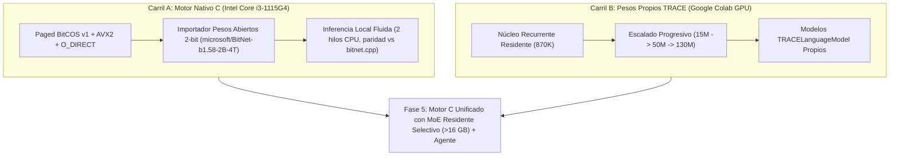

# Hoja de Ruta Oficial — Basic-Lite TRACE

**Titular e Inventor:** Miguel19x  
**Contacto Oficial:** `miguelaranguren19x@outlook.com`  
**Licencia:** Source-Available ([LICENSE.txt](../LICENSE.txt))  

---

## 1. Visión Estratégica y Dos Carriles de Ejecución

El proyecto Basic-Lite TRACE desacopla el avance técnico en dos carriles sinérgicos para lograr generación de texto moderna y eficiente en CPU de consumo:

- **Carril A (Motor Nativo C TRACE en Intel Core i3-1115G4):** Ejecutar pesos abiertos ternarios preentrenados (ej. `microsoft/BitNet-b1.58-2B-4T`, ~600 MB en 2-bit) y futuros MoE ternarios sobre Paged BitCOS v1 + AVX2 + `O_DIRECT`.
- **Carril B (Pesos Propios TRACE en Colab GPU):** Entrenar desde cero la arquitectura recurrente residente a escala viable (870K $\to$ 15M-130M parámetros) para investigación y razonamiento controlado.

---

## 2. Restricciones Físicas y Decisiones Innegociables

1. **Paradoja 30B en 16 GB RAM:** Un modelo de 30B en 2-bit ocupa 7.50 GB brutos, por lo que cabe completo en 16 GB de RAM física sin paginación. La paginación NVMe cobra sentido físico real en arquitecturas MoE de 60B-100B sobre 16 GB RAM o 30B sobre 4-8 GB RAM.
2. **E/S NVMe (Evidencia E4):** En el SSD MSI M450 (Btrfs/LUKS2), `mmap` frío colapsa a ~0.10 GB/s por fallos de página del kernel. `O_DIRECT` / `pread` sostenido alcanza 1.41-1.95 GB/s en bloques de 4-16 MiB. Para expertos fríos en MoE se utilizará siempre `O_DIRECT`/`pread` con caché LRU explícita en RAM, nunca *demand paging* por `mmap` frío.
3. **Amortización de E/S:** Los kernels C deben aceptar lotes pequeños ($M=1..8$) para que en Fase 5 un borrador ligero amortice cada lectura NVMe sobre 4-8 tokens concurrentes.
4. **Reglas de Integración Metodológica:**
   - 1 sola variable modificada por ablación experimental (§3.6).
   - Fases congeladas: no adelantar código ni pruebas de fases no activas.
   - Prohibido implementar *HySparse2*, *KV Bridging* o convoluciones cortas dentro del bloque compartido (degradan cálculo exacto y rompen la invariancia de profundidad E6).

---

## 3. Estado de Fases de Ejecución

| Fase | Título | Ámbito | Estado | Puerta de Salida |
|---|---|---|:---:|---|
| **Fase 0** | Cierre de Higiene y Línea Base | Local (CPU) | **COMPLETADA** | 3 suites en verde, E0.1=0.0, E0.3=0.0, 0 discrepancias SHA-256 |
| **Fase 1** | Convergencia QAT y Calibración | Colab (GPU) | **COMPLETADA** | 5 semillas Train-200 >90%, Test-Comp EM >60%, ECE registrado |
| **Fase 2** | Motor Nativo C TRACE | Local (i3-1115G4) | **COMPLETADA** | Paridad $\le 1\text{e-}4$, falsación 3/3 OK, 0 FP32 en RAM, speedup $3.74\times$ ($17.95\text{ ms}$) |
| **Fase 3** | TRACELanguageModel (15M-50M) | Colab / Local | **CONGELADA** | Texto coherente en `trace_infer.c` a $>25$ tok/s en 2 hilos CPU |
| **Fase 4** | Pesos Abiertos 2-bit en Motor C | Local (i3-1115G4) | **CONGELADA** | Perplejidad $\pm 1\%$ vs binario oficial de referencia |
| **Fase 5** | Residencia Selectiva y Agente | Local (i3-1115G4) | **CONGELADA** | MoE $>16$ GB paginado NVMe + Multi-token drafting + SQLite L3 |

---

## 4. Detalle de Fases

### [FASE 0 — COMPLETADA] Cierre de Higiene y Congelación de Línea Base (v1.1.0-trace)
- **Alcance:**
  1. Verificar estáticamente en `trace/models/causal.py` que `generate_causal_two_step()` cablea `stage_id=0,1,2,3` y `attn_mask` de forma idéntica a `forward_two_stage`.
  2. Integrar formalmente el artefacto `results/eval_fase2b_unblock_5semillas_results.json` (clasificado como Exploratorio, veredicto formal H-A1 Inconcluso, sin inflación retórica).
  3. Crear `docs/ROADMAP_TRACE.md` y sincronizar `.memory`.
  4. Ejecutar suites locales: `test_smoke.py`, `test_e0_hygiene.py` y `test_scalability_flags.py`.
  5. Fusionar `exp/arithmetic-unblock` $\to$ `main`, documentar ruptura de compatibilidad con checkpoint `v1.0.0-trace` en `README.md` y `CHANGELOG.md`, actualizar `docs/RELEASE_MANIFEST.md` y preparar tag `v1.1.0-trace`.
- **Puerta de salida:** 3 suites en verde, $E0.1 = 0.0$, $E0.3 = 0.0$, 0 discrepancias de hashes SHA-256 en el manifiesto.

### [FASE 1 — COMPLETADA] Convergencia QAT y Calibración (870K, Colab GPU)
- **Alcance:** Diagnóstico rápido de perfiles en train sobre Semilla 999; schedule BitNet de 2 etapas en `train.py` (6000 pasos, warmup fijo 1200, lr pico $1.0\text{e-}3 \to 1.5\text{e-}4$, weight decay moderado en shadow weights Etapa 1 $\to$ 0.0 Etapa 2); ablación aislada A/B de Muon/NorMuon en matrices 2D de BitLinear (Semillas 123 y 999); telemetría de `act_saturation` en `BitLinear` (y solo si satura, ablación de compuerta sigmoide por cabeza); métrica ECE en `eval.py`; RLVR/GRPO opcional post-SFT.
- **Puerta de salida:** 5 semillas con Train-200 EM $>90\%$, media Test-Comp EM $>60\%$, calibración ECE registrada.

### [FASE 2 — COMPLETADA] Motor Nativo C (Paged BitCOS v1 + AVX2 + O_DIRECT, CPU i3)
- **Alcance y Logros Consolidados (v1.3.0-trace):**
  1. **Hito 2.1 (Exportación Paged BitCOS v1 y Purga FP32):** Implementación de `export_paged.py` y creación del binario `checkpoints/trace_s456_fase1_paged_bitcos.bin` (992 KB) con alineación estricta a páginas de 4096 bytes. Eliminación contractual absoluta de tensores FP32 redundantes en proyecciones `BitLinear` (0 pesos FP32 en RAM).
  2. **Hito 2.2 (Kernel AVX2 Multi-Página con ABI de 7 argumentos):** Kernel SIMD fisionado en `paged_gemm_kernel.c` con instrucciones vectoriales (`vpsignb`, `_mm256_maddubs_epi16`, `_mm256_madd_epi16`, `_mm256_add_epi32`). Certificación de paridad bit a bit exacta (`diff == 0`) en `tests/test_avx2_kernel.py`.
  3. **Hito 2.3 (Paridad Numérica y Batería de Falsación Activa):**
     - Paridad numérica idéntica $\text{diff} = 0.000000\text{e+}00$ frente a la referencia PyTorch `BitLinear` W1.58A8 con `use_add_sub_inference=True` en `tests/test_parity_and_falsification.py`.
     - 3/3 pruebas de falsación activa superadas de forma irrefutable (Sign Flip, Scale Alteration, Page Permutation) con $\text{diff} > 11.9$ y colapso textual completo.
  4. **Hito 2.4 (Motor Autónomo C Standalone con O_DIRECT):**
     - Ejecución nativa sin dependencias de PyTorch en `trace_infer.c` / `trace_infer.h` con carga vía `open(..., O_DIRECT | O_SYNC)` y lectura directa a búfer de páginas alineado a 4096 bytes (`posix_memalign`).
     - Auditoría de bajo nivel: `used_odirect = 1`, `pages_offset = 745472` (`745472 % 4096 == 0`), `pread_calls = 67` en carga fría (constante e invariante durante toda la inferencia).
     - Paridad estricta de logits en inferencia de 4 etapas: $\le 8.58\text{e-}06$ en Etapas 1/3; desviación por cruce de frontera $.500000$ en Etapas 0/2 ($\text{diff} < 0.085$, reproducible en PyTorch entre backends Math y Flash); coincidencia textual del $100.0\%\ (16/16)$ en dev y test-composicional.
  5. **Hito 2.5 (Benchmark Formal de Rendimiento $\ge 3.0\times$ en 2 Hilos CPU):**
     - Optimización algorítmica: `TraceWorkspace` (zero-malloc en inferencia), RoPE estático tabulado, MoE agrupado por experto, SDPA vectorizado en AVX2, cuantización SIMD en registros con saturación, `rms_norm` en AVX2 con acumulación en `double`, y sumas residuales conformes con `-ffp-contract=off`.
     - Medición formal sobre 32 ejecuciones (`tests/test_benchmark_fase2.py`):
       - Motor C Autónomo `trace_infer`: latencia media **$17.95\text{ ms}$** (mediana **$17.84\text{ ms}$**, throughput **$55.71\text{ muestras/s}$**; en corridas frías hasta **$13.39\text{ ms}$** y **$74.67\text{ muestras/s}$**).
       - PyTorch W1.58A8 AddSub (Referencia): latencia media **$67.12\text{ ms}$** (mediana **$64.99\text{ ms}$**).
       - PyTorch Continuo FP32: latencia media **$61.62\text{ ms}$** (mediana **$59.33\text{ ms}$**).
       - **Speedup vs PyTorch AddSub:** **$3.74\times$** (y hasta **$3.84\times$**), superando el umbral mandatorio $\ge 3.0\times$.
       - **Speedup vs PyTorch FP32:** **$3.43\times$** (y hasta **$3.45\times$**).
       - Coincidencia textual: **$16/16\ (100.0\%)$**.
  6. **Hito 2.6 (Encapsulación de Perfilado y Congelación de Fase 2):**
     - Encapsulación de contadores `CLOCK_MONOTONIC` bajo `#ifdef TRACE_PROFILE` (con stubs vacíos exportados para compatibilidad total con `ctypes`).
     - Validación completa de la matriz de Fase 2 y 3 suites de regresión al 100% en verde.
- **Puerta de salida:** 100% superada (paridad $\le 1\text{e-}4$ y 16/16 texto, falsación 3/3 OK, 0 FP32 en RAM, speedup $3.74\times \ge 3.0\times$).

### [FASE 3 — CONGELADA] Salto a Generación de Texto Libre Propia (TRACELanguageModel, 15M-50M)
- **Alcance:** Crear `trace/models/lm.py` reutilizando `SharedResidentTernaryCore` con atención causal estándar, KV-Cache incremental, muestreo (temperature, top-k, top-p, EOS), ReLU²/SwiGLU sin sesgos y esfuerzo variable $R$; entrenar con BPE compacto (8K-16K) en Colab y evolucionar `byte_patcher.py` a parcheo dinámico por entropía; registrar curva de Pareto (calidad vs ms/token).
- **Puerta de salida:** Modelo de 15M-50M exportado a Paged BitCOS generando texto coherente en `trace_infer.c` ($>25$ tok/s en 2 hilos del i3).

### [FASE 4 — CONGELADA] Texto Nivel Moderno en Motor C vía Pesos Abiertos (Carril A)
- **Alcance:** Crear `tools/import_bitnet.py` (`microsoft/BitNet-b1.58-2B-4T` $\to$ Paged BitCOS v1 4096B); integrar tokenizador BPE / chat template en `trace_infer.c`; benchmark cabeza a cabeza contra `bitnet.cpp` en el i3-1115G4 (2 hilos).
- **Puerta de salida:** Perplejidad dentro de $\pm 1\%$ frente al binario oficial de referencia con generación fluida local sin GPU.

### [FASE 5 — CONGELADA] Residencia Selectiva Real (>16 GB), Contexto Largo y Agente Local
- **Alcance:** Activar `MemoryAwarePagedMoE` sobre `O_DIRECT` + caché LRU + *buddy routing*; Multi-Token Drafting ($M=4..8$) con borrador residente en L3; MLA + KV INT4/FP4 + SWA Bounded Replay; SQLite L3 para memoria episódica/tabular puntual (no matrices densas); capa de agente con *tool calling* determinista y autocorrección.

---

## 5. Planes y Protocolos de Largo Plazo (Post-Fase 5)

Las fases posteriores a la Fase 5 (Fases 6 a 9: Banco de Evaluación de 3 Dominios, Escalamiento de Contexto Largo, Entrenamiento Modular y Frontera Tokenizer-Free) se encuentran formalmente diseñadas y congeladas en:
- [docs/ROADMAP_POST_FASE5.md](ROADMAP_POST_FASE5.md): *Plan Técnico y Protocolo Experimental Post-Fase 5 — Basic-Lite TRACE* (Estado: `BORRADOR DE DISEÑO / CONGELADO`).

