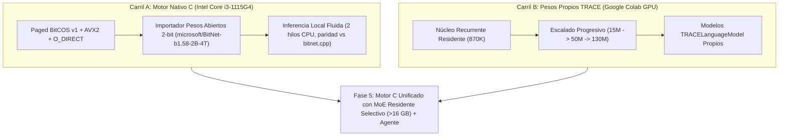

# Hoja de Ruta Oficial — Basic-Lite TRACE

**Titular e Inventor:** Miguel19x  
**Contacto Oficial:** `miguelaranguren19x@outlook.com`  
**Licencia:** Source-Available ([LICENSE.txt](../LICENSE.txt))  

---

## 1. Visión Estratégica y Dos Carriles de Ejecución

El proyecto Basic-Lite TRACE desacopla el avance técnico en dos carriles sinérgicos para lograr generación de texto moderna y eficiente en CPU de consumo:

- **Carril A (Motor Nativo C TRACE en Intel Core i3-1115G4):** Ejecutar pesos abiertos ternarios preentrenados (ej. `microsoft/BitNet-b1.58-2B-4T`, ~600 MB en 2-bit) y futuros MoE ternarios sobre Paged BitCOS v1 + AVX2 + `O_DIRECT`.
- **Carril B (Pesos Propios TRACE en Colab GPU):** Entrenar desde cero la arquitectura recurrente residente a escala viable (870K $\to$ 15M-130M parámetros) para investigación y razonamiento controlado.

---

## 2. Restricciones Físicas y Decisiones Innegociables

1. **Paradoja 30B en 16 GB RAM:** Un modelo de 30B en 2-bit ocupa 7.50 GB brutos, por lo que cabe completo en 16 GB de RAM física sin paginación. La paginación NVMe cobra sentido físico real en arquitecturas MoE de 60B-100B sobre 16 GB RAM o 30B sobre 4-8 GB RAM.
2. **E/S NVMe (Evidencia E4):** En el SSD MSI M450 (Btrfs/LUKS2), `mmap` frío colapsa a ~0.10 GB/s por fallos de página del kernel. `O_DIRECT` / `pread` sostenido alcanza 1.41-1.95 GB/s en bloques de 4-16 MiB. Para expertos fríos en MoE se utilizará siempre `O_DIRECT`/`pread` con caché LRU explícita en RAM, nunca *demand paging* por `mmap` frío.
3. **Amortización de E/S:** Los kernels C deben aceptar lotes pequeños ($M=1..8$) para que en Fase 5 un borrador ligero amortice cada lectura NVMe sobre 4-8 tokens concurrentes.
4. **Reglas de Integración Metodológica:**
   - 1 sola variable modificada por ablación experimental (§3.6).
   - Fases congeladas: no adelantar código ni pruebas de fases no activas.
   - Prohibido implementar *HySparse2*, *KV Bridging* o convoluciones cortas dentro del bloque compartido (degradan cálculo exacto y rompen la invariancia de profundidad E6).

---

## 3. Estado de Fases de Ejecución

| Fase | Título | Ámbito | Estado | Puerta de Salida |
|---|---|---|:---:|---|
| **Fase 0** | Cierre de Higiene y Línea Base | Local (CPU) | **COMPLETADA** | 3 suites en verde, E0.1=0.0, E0.3=0.0, 0 discrepancias SHA-256 |
| **Fase 1** | Convergencia QAT y Calibración | Colab (GPU) | **ACTIVA** | 5 semillas Train-200 >90%, Test-Comp EM >60%, ECE registrado |
| **Fase 2** | Motor Nativo C TRACE | Local (i3-1115G4) | **CONGELADA** | Paridad $\le 1\text{e-}4$, test falsación OK, 0 FP32 en RAM, $\ge 3\times$ speedup |
| **Fase 3** | TRACELanguageModel (15M-50M) | Colab / Local | **CONGELADA** | Texto coherente en `trace_infer.c` a $>25$ tok/s en 2 hilos CPU |
| **Fase 4** | Pesos Abiertos 2-bit en Motor C | Local (i3-1115G4) | **CONGELADA** | Perplejidad $\pm 1\%$ vs binario oficial de referencia |
| **Fase 5** | Residencia Selectiva y Agente | Local (i3-1115G4) | **CONGELADA** | MoE $>16$ GB paginado NVMe + Multi-token drafting + SQLite L3 |

---

## 4. Detalle de Fases

### [FASE 0 — COMPLETADA] Cierre de Higiene y Congelación de Línea Base (v1.1.0-trace)
- **Alcance:**
  1. Verificar estáticamente en `trace/models/causal.py` que `generate_causal_two_step()` cablea `stage_id=0,1,2,3` y `attn_mask` de forma idéntica a `forward_two_stage`.
  2. Integrar formalmente el artefacto `results/eval_fase2b_unblock_5semillas_results.json` (clasificado como Exploratorio, veredicto formal H-A1 Inconcluso, sin inflación retórica).
  3. Crear `docs/ROADMAP_TRACE.md` y sincronizar `.memory`.
  4. Ejecutar suites locales: `test_smoke.py`, `test_e0_hygiene.py` y `test_scalability_flags.py`.
  5. Fusionar `exp/arithmetic-unblock` $\to$ `main`, documentar ruptura de compatibilidad con checkpoint `v1.0.0-trace` en `README.md` y `CHANGELOG.md`, actualizar `docs/RELEASE_MANIFEST.md` y preparar tag `v1.1.0-trace`.
- **Puerta de salida:** 3 suites en verde, $E0.1 = 0.0$, $E0.3 = 0.0$, 0 discrepancias de hashes SHA-256 en el manifiesto.

### [FASE 1 — ACTIVA] Convergencia QAT y Calibración (870K, Colab GPU)
- **Alcance:** Diagnóstico rápido de perfiles en train sobre Semilla 999; schedule BitNet de 2 etapas en `train.py` (6000 pasos, warmup fijo 1200, lr pico $1.0\text{e-}3 \to 1.5\text{e-}4$, weight decay moderado en shadow weights Etapa 1 $\to$ 0.0 Etapa 2); ablación aislada A/B de Muon/NorMuon en matrices 2D de BitLinear (Semillas 123 y 999); telemetría de `act_saturation` en `BitLinear` (y solo si satura, ablación de compuerta sigmoide por cabeza); métrica ECE en `eval.py`; RLVR/GRPO opcional post-SFT.
- **Puerta de salida:** 5 semillas con Train-200 EM $>90\%$, media Test-Comp EM $>60\%$, calibración ECE registrada.

### [FASE 2 — CONGELADA] Motor Nativo C (Paged BitCOS v1 + AVX2 + O_DIRECT, CPU i3)
- **Alcance:** Eliminar tensores FP32 redundantes en `PagedBitCOSReader.load_into_model`; conectar `use_add_sub_inference` en `TRACECausalModel`; eliminar sesgos (`bias=False`) en `noise_mlp` y `halt_gate`; alinear filas fast a múltiplos de 16 pesos; crear `export_paged.py`; implementar AVX2 real (I2_S con `_mm256_maddubs_epi16`, luego TL2 LUT con PSHUFB) en `paged_gemm_kernel.c` con soporte $M=1..8$ y `omp_set_num_threads(2)`; crear runner C autónomo `trace_infer.c` (RAM alineada $\le 16$ GB y módulo `O_DIRECT` 4-16 MiB para escalado).
- **Puerta de salida:** Paridad numérica $\le 1\text{e-}4$ vs PyTorch, test de falsación superado, cero tensores FP32 de pesos en RAM, $\ge 3\times$ aceleración en i3-1115G4.

### [FASE 3 — CONGELADA] Salto a Generación de Texto Libre Propia (TRACELanguageModel, 15M-50M)
- **Alcance:** Crear `trace/models/lm.py` reutilizando `SharedResidentTernaryCore` con atención causal estándar, KV-Cache incremental, muestreo (temperature, top-k, top-p, EOS), ReLU²/SwiGLU sin sesgos y esfuerzo variable $R$; entrenar con BPE compacto (8K-16K) en Colab y evolucionar `byte_patcher.py` a parcheo dinámico por entropía; registrar curva de Pareto (calidad vs ms/token).
- **Puerta de salida:** Modelo de 15M-50M exportado a Paged BitCOS generando texto coherente en `trace_infer.c` ($>25$ tok/s en 2 hilos del i3).

### [FASE 4 — CONGELADA] Texto Nivel Moderno en Motor C vía Pesos Abiertos (Carril A)
- **Alcance:** Crear `tools/import_bitnet.py` (`microsoft/BitNet-b1.58-2B-4T` $\to$ Paged BitCOS v1 4096B); integrar tokenizador BPE / chat template en `trace_infer.c`; benchmark cabeza a cabeza contra `bitnet.cpp` en el i3-1115G4 (2 hilos).
- **Puerta de salida:** Perplejidad dentro de $\pm 1\%$ frente al binario oficial de referencia con generación fluida local sin GPU.

### [FASE 5 — CONGELADA] Residencia Selectiva Real (>16 GB), Contexto Largo y Agente Local
- **Alcance:** Activar `MemoryAwarePagedMoE` sobre `O_DIRECT` + caché LRU + *buddy routing*; Multi-Token Drafting ($M=4..8$) con borrador residente en L3; MLA + KV INT4/FP4 + SWA Bounded Replay; SQLite L3 para memoria episódica/tabular puntual (no matrices densas); capa de agente con *tool calling* determinista y autocorrección.
